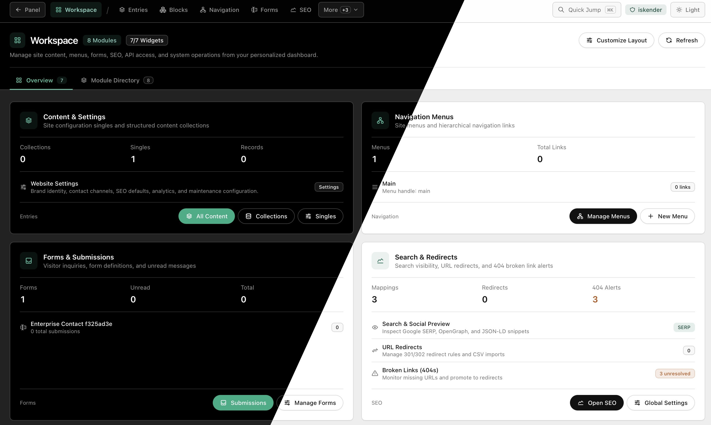

# React

Shared **React 19 + Inertia.js v3 + Tailwind CSS v4** UI runtime, dual-context admin shell (`ProcessReact`), dual-mode form & media controls, Tiptap v3 rich text editor (`InputfieldTiptap`), centralized vector icon engine (`IconManager`), interactive data viewports, typed TypeScript SDK (`@pw/react/*`), and optional `ProcessReactWorkspace` hub for ProcessWire 3.0.271+ and PHP 8.4+.



`React` maps ProcessWire's `--pw-*` admin color scheme variables onto semantic design tokens (`--background`, `--foreground`, `--primary`, `--muted`, `--border`, `--ring`) and compiles each companion module and adapter engine into self-contained `dist/` bundles loaded strictly on demand.

> [!NOTE]
> Installing `React` adds zero top-level admin menu items. An `Admin > Workspace` dashboard launcher appears only when you also install the optional [`ProcessReactWorkspace`](./ProcessReactWorkspace.module.php) module.

---

## Documentation

Deep architectural guides, subsystem walkthroughs, and API references live in [`docs/`](./docs/README.md):

| Context / What You Need | Target Document |
|---|---|
| **Architecture Overview & Component Map** | [docs/ARCHITECTURE.md](./docs/ARCHITECTURE.md) |
| **Documentation Index & Reading Map** | [docs/README.md](./docs/README.md) |
| **System Architecture, Tech Stack, CI, Runtime Surface & ADRs** | [01 — Architecture & Technical Deep-Dive](./docs/01-architecture.md) |
| **Admin Modules, Dual-Context Shell, Flyout Nav, Hub & Central Themes** | [02 — Workspaces, Dual-Context Shell & Themes](./docs/02-workspaces-and-admin-shell.md) |
| **`SchemaForm`, Tabs, Key-Value, Links, Icons, Media Studio, Relations & Tiptap** | [03 — Inputfields, Forms & Rich Text (`InputfieldTiptap`)](./docs/03-inputfields-forms-and-tiptap.md) |
| **`MarkupReactTable`, `MarkupReactCards`, Pluggable Modes & Capability Providers** | [04 — Viewports & Data Providers](./docs/04-viewports-and-data-providers.md) |
| **21-Pass Vite Build, `@pw/react/*` SDK, Delta CSS Layers, i18n & Security** | [05 — Frontend Runtime, Typed SDK, i18n & Security](./docs/05-frontend-runtime-sdk-and-security.md) |
| **Complete PHP & Asset Reference Dictionary** | [API.md](./API.md) |
| **Internal Contributor Invariants & Boundaries** | [AGENTS.md](./AGENTS.md) |

---

## Requirements

- **PHP:** `>= 8.4`
- **ProcessWire:** `>= 3.0.271`
- **Required Module:** `Inertia` (`Totoglu\Inertia`)

---

## Installation

```bash
composer require trk/processwire-react
php vendor/bin/wire module:install --name=React --json
# Optional unified Admin > Workspace dashboard & cross-module switcher:
php vendor/bin/wire module:install --name=ProcessReactWorkspace --json
```

Installing `React` automatically installs all **14 companion modules** (`ProcessReactWorkspace` remains optional):

| Companion Modules | Role & Guide |
|---|---|
| `MarkupReactTable`, `MarkupReactCards` | Sortable, filterable, inline-editable table and responsive card viewports ([04 — Viewports](./docs/04-viewports-and-data-providers.md)) |
| `MarkupReactTab` | WAI-ARIA tab container (`line`, `segmented`, `vertical`) with `lazyLoad` and nested asset handling ([03 — Inputfields](./docs/03-inputfields-forms-and-tiptap.md#tabs-key-value--polymorphic-link-controls)) |
| `InputfieldReactKeyValue`, `InputfieldReactLink` | Associative key-value editor and multi-target polymorphic link control with isolated link media ([03 — Inputfields](./docs/03-inputfields-forms-and-tiptap.md#tabs-key-value--polymorphic-link-controls)) |
| `InputfieldReactIcon` | Searchable `6,545`-variant vector icon picker (`5,491` outline + `1,054` filled) and CSS `mask-image` admin icon engine ([03 — Vector Icons](./docs/03-inputfields-forms-and-tiptap.md#centralized-vector-icon-engine-inputfieldreacticon--iconmanager)) |
| `InputfieldReactM2O`, `M2M`, `O2M`, `M2A` | Relational pickers backed by 8 core resource adapters and lazy custom adapters ([03 — Relations](./docs/03-inputfields-forms-and-tiptap.md#relational-pickers-m2o-m2m-o2m-m2a--_reactrelation)) |
| `InputfieldTiptap`, `TextformatterTiptapMiniBlocks` | Tiptap v3 rich text editor (`core`/`editor`/`canvas`/`blocks`), native link/image dialogs, and flat mini-blocks ([03 — Tiptap](./docs/03-inputfields-forms-and-tiptap.md#rich-text-editor-inputfieldtiptap--textformattertiptapminiblocks)) |
| `InputfieldReactFile`, `InputfieldReactImage` | Dropzone upload studio, focus/crop/rotate/flip editor, palette inspection, and multi-language alt/description metadata ([03 — Media Studio](./docs/03-inputfields-forms-and-tiptap.md#media-studio-inputfieldreactimage-inputfieldreactfile-mediagateway)) |

---

## Quick Start

### 1. Build a Dual-Context Admin Module (`ProcessReact`)

Extend `Totoglu\React\Inertia\ProcessReact` so a single React component runs natively inside `AdminTheme` via `Setup > <Module>` and full-screen inside `Admin > Workspace` (`?ws=1`) when `ProcessReactWorkspace` is installed, with clickable flyout navigation via `buildAdminNavJSON()`. Register workspaces lazily via `React::deferModuleRegistration()` and navigation icons eagerly during `init()` ([02 — Workspaces & Admin Shell](./docs/02-workspaces-and-admin-shell.md)).

```php
<?php

declare(strict_types=1);

namespace ProcessWire;

use Totoglu\React\Icon\IconManager;
use Totoglu\React\Inertia\ProcessReact;

class ProcessCatalog extends ProcessReact
{
	public function init(): void
	{
		parent::init();

		IconManager::registerAdminIcons(['layout-dashboard', 'shopping-bag']);

		React::deferModuleRegistration(
			$this,
			function (React $react): void {
				$react->workspaces()->register([
					'id' => 'catalog',
					'title' => $this->_('Catalog'),
					'description' => $this->_('Manage products, pricing tiers, and inventory.'),
					'icon' => 'shopping-bag',
					'process' => 'ProcessCatalog',
					'component' => 'Catalog/Workspace',
					'permission' => 'catalog-view',
				]);
			}
		);
	}

	/**
	 * @param array<string, mixed> $options
	 * @return string|array<string, mixed>
	 */
	public function ___executeNavJSON(array $options = []): string|array
	{
		if (!$this->wire()->user->hasPermission('catalog-view')) {
			throw new WirePermissionException($this->_('Access denied.'));
		}

		return $this->buildAdminNavJSON([
			['url' => '', 'label' => $this->_('Overview'), 'icon' => 'layout-dashboard'],
			['url' => 'products/', 'label' => $this->_('Products'), 'icon' => 'shopping-bag', 'separator' => true],
		], $options);
	}

	public function ___execute(): string
	{
		$react = React::instance($this);

		return (string) $this->inertiaRender('Catalog/Workspace', [
			'table' => $react->configureTable('pages:template=product, limit=25', [
				'title' => $this->_('Products'),
				'columns' => [
					'title' => $this->_('Title'),
					'modified' => $this->_('Modified'),
					'status' => $this->_('Status'),
				],
				'sortableColumns' => ['title', 'modified', 'status'],
				'quickEditEnabled' => true,
				'exportEnabled' => true,
			]),
		]);
	}
}
```

### 2. Render Standalone Interactive Viewports

Render `MarkupReactTable` or `MarkupReactCards` inside any classic ProcessWire admin screen or frontend template ([04 — Viewports & Data Providers](./docs/04-viewports-and-data-providers.md)):

```php
<?php

declare(strict_types=1);

namespace ProcessWire;

$react = React::instance($this);

echo $react->renderTable('pages:template=basic-page, limit=20', [
	'title' => $this->_('Site Pages'),
	'columns' => [
		'title' => $this->_('Title'),
		'path' => $this->_('Path'),
		'modified' => $this->_('Modified'),
		'status' => $this->_('Status'),
	],
]);
```

### 3. Render Vector Icons (`InputfieldReactIcon` & `IconManager`)

Attach `InputfieldReactIcon` to any `FieldtypeText` field or invoke `IconManager` directly ([03 — Vector Icons](./docs/03-inputfields-forms-and-tiptap.md#centralized-vector-icon-engine-inputfieldreacticon--iconmanager)):

```php
<?php

declare(strict_types=1);

namespace ProcessWire;

/** @var Page $page */
$icon = $page->hero_icon; // ReactIconValue when $page->of(true)
if (!$icon->isEmpty()) {
	echo $icon;
}

echo React::instance($this)->icons()->renderSvg('sparkles', [
	'variant' => 'filled',
	'size' => 24,
	'color' => '#0d9488',
]);
```

---

## Configuration

Configure site-wide defaults under **Modules > Configure > React** ([`React::getModuleConfigInputfields()`](./React.module.php#L2414-L2538)):

| Setting | Type | Default | Description |
|---|---|---|---|
| `defaultTheme` | `string` | `'system'` | Fallback mode (`'system'`, `'light'`, `'dark'`). |
| `themePreset` | `string` | `'native'` | Central preset across workspaces, panels, overlays, and controls (`native`, `neutral`, `slate`, `stone`, `ocean`, `indigo`, `teal`, `custom`). |
| `themeCustomTokens` | `string` | `''` | Sanitized Tailwind CSS v4 `:root` / `.dark` variables used when `themePreset` is `custom` (requires `--background`, `--foreground`, `--primary`, `--primary-foreground`). |
| `defaultShellLayout` | `string` | `'topbar'` | Default navigation shell layout applied across React workspaces when a user has not chosen a personal override (`'topbar'`, `'sidebar'`, or registered custom layout ID). |
| `enableKeyboardShortcuts` | `bool` | `true` | Enables `Cmd/Ctrl+K` command palette, `Cmd/Ctrl+B` sidebar toggle, `?` help dialog, form save shortcuts, and viewport hotkeys. |
| `adminReturnLabel` | `string` | `'Panel'` | Localized top-left return label in Workspace mode (supports multi-language values). |
| `useReactMediaFields` | `bool` | `false` | Upgrades standard `InputfieldImage` / `InputfieldFile` fields on Pages (including Repeaters) to `InputfieldReactImage` / `InputfieldReactFile`. |
| `enableAdminVectorIcons` | `bool` | `true` | Injects the `Vector Icon` picker on Templates/Fields and generates `site/assets/vector-icons/VectorIcons.css`. |
| `adminIconPreviewSize` | `int` | `28` | Preview size in pixels (`16`–`64`) on `Edit Template` and `Edit Field`. |

> [!TIP]
> Authenticated users can choose personal theme modes, color presets, panel layout (`topbar` / `sidebar`), and collapsed sidebar rail state from the Workspace account menu (persisted to `site/assets/cache/React/workspaces/{user-id}.json`). See [02 — Theme Engine](./docs/02-workspaces-and-admin-shell.md#centralized-theme-engine-thememanager).

---

## Hooks & Extension Seams

All discovery hooks execute lazily on first registry access (`React::deferModuleRegistration`, `deferShellLayoutRegistration`, `deferCommandSearchRegistration`, `deferProviderRegistration`, `deferRelationRegistration`, `deferMediaHostRegistration` in [`React.module.php`](./React.module.php#L1194,L1493,L1551,L1812,L1909,L735)):

- **Hookable `React` Methods:** `___initWorkspaceRegistry()`, `___registerWorkspaces()`, `___getWorkspaceDefinitions()`, `___initWidgetRegistry()`, `___registerWidgets()`, `___getWidgetDefinitions()`, `___registerShellLayouts()`, `___registerCommandSearch()`, `___initProviderRegistry()`, `___registerProviders()`, `___initRelationRegistry()`, `___registerRelationResources()`, `___registerMediaHosts()`, `___translations()`.
- **Editorial Mini-Block Hook:** `InputfieldTiptap::registerMiniBlocks` for adding custom flat `[data-tiptap-block]` types rendered via `./site/templates/tiptap/{name}.php`.
- **Hooks & Signatures:** See [API.md](./API.md) (including `FormSchemaSerializer` `surface: 'card'` native tabs-over-card `[data-rw-card-tabs="above"]`, `appendDeleteTab()`, `WireTab` metadata preservation, `[data-rw-meta-*]`/`[data-rw-ref-*]`/`[data-rw-rev-table]`/`[data-rw-diff-pill]` semantic CSS contracts, and canonical controls: `date`, `time`, `datetime`, `daterange`, `color`, `tags`, `combobox`, `unit_number`/`currency` with `unitVariant: 'currency'`, `segmented`, `spacing`, `range`, `range_slider`, `colspan`, `otp`, `password`, `markdown`, `rating`, `signature`, `calculation`, `repeater`, `keyvalue`, `link`, `icon`, `relation`, `file`, `image`, `tiptap`).
- **Full Signature Dictionary:** See [API.md](./API.md) and chapters [`02`](./docs/02-workspaces-and-admin-shell.md)–[`04`](./docs/04-viewports-and-data-providers.md).

---

## Internal Endpoints & Multi-Language Packs

`React` registers eight URL hooks ([`React.module.php`](./React.module.php#L371-L378)) and delivers native ProcessWire `LanguageTranslator` catalogs via locale-scoped Inertia `OnceProp` keys (`languages/{en,tr,de,fr,es,ru}.csv`):

| Endpoint | Purpose |
|---|---|
| `/_react/viewport` | Signed table/cards/pluggable viewport queries, inline/quick edits, bulk actions, saved views, and exports |
| `/_react/workspace-prefs` | Per-user Workspace favorites, Bento grid layout JSON import/export, `themeMode`, `themePreset`, `shellLayout`, and `sidebarCollapsed` |
| `/_react/presence` | Concurrent co-editor heartbeats (`15s`) and remote-save staleness alerts |
| `/_react/relation` | Signed relational search, tree loading, hydration, and `O2M` link/unlink/quick-create actions |
| `/_react/media` | Signed multipart file/image uploads, replacement, crop/rotate/flip transforms, and palette inspection |
| `/_react/tiptap` | Signed page/file/anchor lookup and `-is` `Pageimage` variation/upload gateway |
| `/_react/icons` | Read-only `GET` paginated catalog search (`action=query`) and microtask hydration (`action=hydrate`) |
| `/_react/command-search` | Read-only `GET` RBAC-scoped command palette search across registered providers and editable pages |

---

## Security & Verification

> [!IMPORTANT]
> State-changing `/_react/*` requests enforce authenticated users (`AccessGuard`), `$session->CSRF` validation (`X-CSRF-TOKEN` / `X-XSRF-TOKEN` / request `_token`), `POST` method checks, demo-mode guards, `2 MiB` / depth-`64` JSON limits, and HMAC-SHA256 tokens bound to `$user->id` (`uid`), `$config->userAuthSalt`, domain `typ`, and 24-hour `iat` TTL (`SignedTokenCodec`). See [05 — Security Architecture](./docs/05-frontend-runtime-sdk-and-security.md#security-architecture).

Run verification checks sequentially against the workspace root (details and CI gates in [01 — Architecture](./docs/01-architecture.md#commands--verification-inventory)):

```bash
composer --working-dir=site/modules/React validate --strict --no-check-publish --no-check-version
./vendor/bin/phpstan analyse -c site/modules/React/phpstan.neon --no-progress --memory-limit=1G
npm --prefix site/modules/React run build
npm --prefix site/modules/React run test:unit
php vendor/bin/wire test site/modules/React/tests --json
php vendor/bin/wire test:e2e --module=React --json
php vendor/bin/wire boost:validate --module=React --strict --json
```
