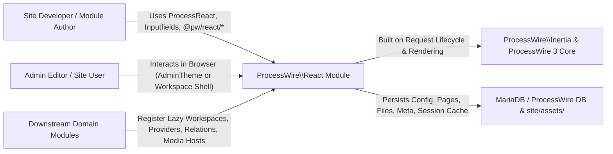
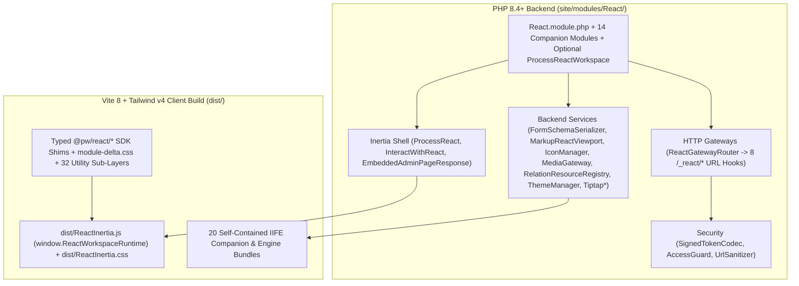
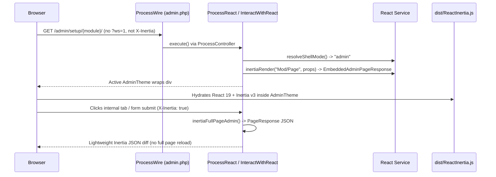

# 01 — Architecture & Technical Deep-Dive

Architectural baseline and local-checkout audit for `ProcessWire\React` (`Totoglu\React`, `site/modules/React/`). Every claim in this document is verified against source files on disk at snapshot `main@fdfa15f`; items that depend on remote repository settings or external runtime configuration are explicitly tagged `[INFERRED]` or `[UNVERIFIED]`.

---

## Part 1 — Whole-Repo Technical Deep-Dive

### What `React` Is

`React` is an autoloaded ProcessWire 3 module that supplies a shared **React 19 + Inertia.js v3 + Tailwind CSS v4** frontend runtime, the dual-context `ProcessReact` admin controller, 14 companion `Markup*` / `Inputfield*` / `Textformatter*` modules, a centralized vector icon engine (`IconManager`), interactive data viewports, a Tiptap v3 rich text editor (`InputfieldTiptap`), a typed downstream client SDK (`@pw/react/*`), and optional `ProcessReactWorkspace` (`Admin > Workspace`) hub orchestration ([README.md](../README.md#L1-L10), [React.module.php](../React.module.php#L34-L57)). It registers zero admin pages of its own unless the optional `ProcessReactWorkspace` module is installed ([React.module.php](../React.module.php#L103-L136), [ProcessReactWorkspace.module.php](../ProcessReactWorkspace.module.php#L25-L50)).

---

### Tech-Stack Detection Table

| Layer | Technology | Pinned / Minimum Constraint | Evidence |
|---|---|---|---|
| **Server Runtime** | PHP | `>= 8.4` (`8.4` & `8.5` in CI) | [composer.json](../composer.json#L29), [ci.yml](../.github/workflows/ci.yml#L22) |
| **CMS & Protocol** | ProcessWire Core & `Inertia` (`trk/processwire-inertia`) | ProcessWire `>= 3.0.271`, `^1.0` | [composer.json](../composer.json#L30), [React.module.php](../React.module.php#L114-L118) |
| **UI Core & Routing** | `react`, `react-dom`, `@inertiajs/react` | `^19.3.1`, `^3.11.0` | [package.json](../package.json#L16-L38) |
| **Primitives & Forms** | `@base-ui/react`, `valibot` | `^1.9.0`, `^1.5.0` | [package.json](../package.json#L12-L40) |
| **Styling System** | `tailwindcss`, `@tailwindcss/vite`, `class-variance-authority`, `clsx`, `tailwind-merge` | `^4.3.5`, `^0.7.1`, `^2.1.1`, `^3.7.0` | [package.json](../package.json#L33-L48) |
| **Viewport Engines** | `@tanstack/react-table`, `@tanstack/react-virtual`, `@dnd-kit/core`, `@dnd-kit/sortable`, `react-day-picker`, `date-fns` | `^9.3.1`, `^3.14.26`, `^6.3.1`, `^10.0.0`, `^10.0.2`, `^4.4.0` | [package.json](../package.json#L13-L38) |
| **Rich Text Editor** | `@tiptap/core`, `@tiptap/react`, `@tiptap/pm`, `@tiptap/starter-kit`, 8 extensions | `^3.34.0` (`tiptapVersion = '3.34.0'`) | [package.json](../package.json#L19-L32), [InputfieldTiptap.module.php](../InputfieldTiptap.module.php#L59) |
| **Frontend Build & Unit Tests** | `vite`, `@vitejs/plugin-react`, `typescript`, `vitest`, `postcss` | `^8.2.0`, `^6.2.1`, `^5.8.0`, `^5.1.0`, Node `22` | [package.json](../package.json#L44-L52), [ci.yml](../.github/workflows/ci.yml#L53) |
| **Static Analysis & Backend Tests** | PHPStan (Level 8, `phpVersion: 80400`), Pest PHP, Playwright | Configured via workspace binaries | [phpstan.neon](../phpstan.neon#L1-L26), [AGENTS.md](../AGENTS.md#L50-L55) |

---

### Entry Points

| Kind | Entry Point | Role | Evidence |
|---|---|---|---|
| **Autoload Module Boot** | `React::__construct()`, `init()`, `ready()` | Registers `Totoglu\React\` autoloader, attaches `/_react/*` URL hooks, registers core hooks, and injects active theme tokens + admin vector icon CSS into admin pages | [React.module.php](../React.module.php#L157-L164), [#L328-L342](../React.module.php#L328-L342), [#L666-L685](../React.module.php#L666-L685) |
| **Optional Hub Process** | `ProcessReactWorkspace` (`extends WorkspaceLauncherProcess`) | Mounts `Admin > Workspace` when explicitly installed (not auto-installed by `React`) | [ProcessReactWorkspace.module.php](../ProcessReactWorkspace.module.php#L20-L50) |
| **Installed Companion Modules (14)** | `MarkupReact*` (3), `InputfieldReact*` (9), `InputfieldTiptap`, `TextformatterTiptapMiniBlocks` | Auto-installed by `React`; each loads only its own isolated bundle(s) on demand | [React.module.php](../React.module.php#L119-L134) |
| **HTTP URL Hooks (8)** | `/_react/viewport`, `workspace-prefs`, `presence`, `relation`, `media`, `tiptap`, `icons`, `command-search` | Signed JSON, search, and multipart endpoints routed through `ReactGatewayRouter` | [React.module.php](../React.module.php#L351-L358), [ReactGatewayRouter.php](../src/Http/ReactGatewayRouter.php) |
| **Frontend Build Entries** | 6 core JS + 4 core CSS + 20 isolated JS passes | Compiled via `vite.config.ts` and `build-bundles.mjs` into `dist/` | [entries.manifest.mjs](../resources/entries.manifest.mjs#L1-L50), [build-bundles.mjs](../resources/build-bundles.mjs#L1-L37) |
| **Standalone HTML Root** | `views/admin.php` | Full-screen HTML document shell used when `shellMode === 'workspace'` | [views/admin.php](../views/admin.php#L1-L106) |

---

### Commands & Verification Inventory

All commands run from the ProcessWire project root unless noted otherwise. PHP/DB suites run sequentially against the shared database ([AGENTS.md](../AGENTS.md#L52-L58)).

| Category | Command | Purpose | Evidence |
|---|---|---|---|
| **PHP Lint** | `find site/modules/React -name "*.php" -not -path "*/vendor/*" -not -path "*/node_modules/*" -exec php -l {} +` | Validates PHP 8.4/8.5 syntax across module files | [ci.yml](../.github/workflows/ci.yml#L34) |
| **Composer Validate** | `composer --working-dir=site/modules/React validate --strict --no-check-publish --no-check-version` | Validates module Composer manifest (`--strict`) | [ci.yml](../.github/workflows/ci.yml#L40) |
| **Cold CLI Boot** | `php vendor/bin/wire version --json` | Verifies ProcessWire & CLI boot with exit code `0` | [AGENTS.md](../AGENTS.md#L50) |
| **Static Analysis** | `./vendor/bin/phpstan analyse -c site/modules/React/phpstan.neon --no-progress --memory-limit=1G` | Runs PHPStan Level 8 across root `.module.php` files and `src/` | [phpstan.neon](../phpstan.neon#L1-L26), [AGENTS.md](../AGENTS.md#L51) |
| **Typecheck** | `npm --prefix site/modules/React run typecheck` | Runs `tsc --noEmit` in strict mode | [package.json](../package.json#L8) |
| **Production Build** | `npm --prefix site/modules/React run build` | Typechecks, builds core runtime (`dist/vector-icons.json` + CSS cascade layers), then runs 20 isolated bundle passes | [package.json](../package.json#L7), [build-bundles.mjs](../resources/build-bundles.mjs#L23-L37) |
| **Frontend Unit Tests** | `npm --prefix site/modules/React run test:unit` | Executes all 18 Vitest specs (`tests/ts/**/*.test.ts`) | [package.json](../package.json#L9), [vitest.config.ts](../vitest.config.ts#L3-L7) |
| **Single TS Test** | `npx --prefix site/modules/React vitest run tests/ts/icons.test.ts` | Runs a single Vitest unit file (`[INFERRED]` CLI filter pattern from `vitest.config.ts`) | [vitest.config.ts](../vitest.config.ts#L5) |
| **Backend Pest Suite** | `php vendor/bin/wire test site/modules/React/tests --json` | Executes all 22 PHP Unit & Feature test suites against ProcessWire | [AGENTS.md](../AGENTS.md#L54) |
| **Single PHP Test** | `php vendor/bin/wire test site/modules/React/tests/Unit/LayeringTest.php --json` | Executes a targeted Pest test file (layering & brand checks) | [LayeringTest.php](../tests/Unit/LayeringTest.php#L333-L380) |
| **E2E & A11y** | `php vendor/bin/wire test:e2e --module=React --json` | Runs the 2 Playwright + WCAG 2.1 AA browser specs | [AGENTS.md](../AGENTS.md#L55) |
| **Boost Check** | `php vendor/bin/wire boost:validate --module=React --strict --json` | Validates `API.md`, `AGENTS.md`, and `.agents/skills` parity `[pw-docs-architect]` | [AGENTS.md](../AGENTS.md#L1-L3) |

**CI Workflow & Enforcement:** [`.github/workflows/ci.yml`](../.github/workflows/ci.yml#L1-L63) runs on `push` and `pull_request` to `main` with two jobs: `lint` (PHP `8.4` and `8.5` syntax lint + Composer strict validation) and `frontend` (Node `22`, `npm ci`, `npm run build`, `npm run test:unit`). Whether `ci.yml` is configured as a required branch-protection check on GitHub is `[UNVERIFIED]` (configured in remote repository settings, not stored on disk). Notice that PHPStan, Pest PHP, and Playwright E2E require a live ProcessWire workspace installation and therefore are not executed inside the standalone module `ci.yml`.

---

### Directory Layout

Exact file counts verified across `site/modules/React/` (excluding `node_modules/` and `.git/`):

| Path | Count | Purpose |
|---|---|---|
| Root `*.module.php` | 16 files | `React.module.php`, optional `ProcessReactWorkspace.module.php`, and 14 companion UI/field modules |
| `src/` (`17` subdirs) | 74 PHP files | `Contract` (9), `Data` (2), `Form` (1), `Hook` (1), `Http` (1), `I18n` (1), `Icon` (2), `Inertia` (5), `Media` (6), `Provider` (3), `Relation` (14), `Security` (3), `Support` (2), `Theme` (3), `Tiptap` (8), `Viewport` (2), `Workspace` (11) |
| `resources/ts/` | 228 TS/TSX files | Entries (`entries/`), SDK (`sdk/`), UI primitives (`ui/`), layout (`layout/`), forms/controls (`fields/`), viewports (`viewports/`), optional engines (`engines/`), Tiptap (`tiptap/`), icons (`icons/`), hooks/utils (`hooks/`, `lib/`, `portal/`) |
| `resources/css/` | 7 CSS files | Core/sub-bundle entries (`entries/`), shared theme variables (`theme-inline.css`), design tokens (`tokens.css`), and downstream mixin (`module-delta.css`) |
| `dist/` | 31 built files | Core JS/CSS, `vector-icons.json` (2.4M), and 20 isolated JS/CSS companion bundles |
| `languages/` | 6 CSV files | `LanguagePorter::exportCsv` translation packs for `en`, `tr`, `de`, `fr`, `es`, `ru` |
| `tests/` | 45 spec files | 22 Pest PHP files (`Unit/` + `Feature/`), 18 Vitest files (`tests/ts/`), 2 Playwright E2E specs (`tests/e2e/`), plus 3 bootstraps/helpers |
| `views/` | 1 PHP view | `views/admin.php` standalone Workspace HTML document shell |
| `.github/` | 8 files | GitHub CI (`workflows/ci.yml`), release workflow (`workflows/release.yml`), templates, and `dependabot.yml` |
| `.agents/skills/pw-react/` | 1 skill | ProcessWire Boost consumer skill playbook (`SKILL.md`) |

---

### Deployment & Runtime Surface

`React` creates **zero custom SQL tables**. All runtime state lives in ProcessWire core stores and module-scoped directories under `site/assets/`:

| Surface / Runtime | Pinned Version or Location | Lifecycle / Evidence |
|---|---|---|
| **PHP Runtime (Prod & CI)** | `>= 8.4` (`8.4` / `8.5` tested in CI; PHPStan targets `80400`) | [composer.json](../composer.json#L29), [phpstan.neon](../phpstan.neon#L3), [ci.yml](../.github/workflows/ci.yml#L22) |
| **Node Build Runtime (Build / CI)** | Node `22` (`setup-node@v7` in CI) | [ci.yml](../.github/workflows/ci.yml#L53) |
| **ProcessWire & `Inertia`** | ProcessWire `>= 3.0.271`, `trk/processwire-inertia ^1.0` | [React.module.php](../React.module.php#L114-L118), [composer.json](../composer.json#L30) |
| **Per-User Workspace & Theme Prefs** | `site/assets/cache/React/workspaces/{user-id}.json` | Persisted by `WorkspacePreferenceStore`; purged on uninstall ([WorkspacePreferenceStore.php](../src/Workspace/WorkspacePreferenceStore.php), [React.module.php](../React.module.php#L1704-L1715)) |
| **Edit Co-Presence Locks** | `site/assets/cache/React/presence/{sha256}.json` | Atomic `flock()` heartbeat files (`45s` TTL); purged on uninstall ([EditPresenceStore.php](../src/Workspace/EditPresenceStore.php)) |
| **Viewport User Preferences** | Session `ReactViewPrefs` + `pages_meta` (`react_view_prefs_%`) | Saved per user & viewport; deleted on uninstall ([ReactViewPreferenceStore.php](../src/Viewport/ReactViewPreferenceStore.php), [React.module.php](../React.module.php#L1694-L1702)) |
| **Admin Vector Icon CSS** | `site/assets/vector-icons/VectorIcons.css` | Generated lazily by `IconManager::generateAdminCss()` (`rwv--*` CSS `mask-image` rules); directory removed on uninstall ([React.module.php](../React.module.php#L1708-L1711)) |
| **Link Media Isolation Dir** | `site/assets/files/{pageId}/links/{fieldName}/` | Isolated per-page/per-field media assets managed by `PageLinkMediaHostAdapter` ([API.md](../API.md#L152)) |

---

### Dependency Health & Maintenance Observations

- **Frontend runtime dependencies (`React 19.3`, `Inertia 3.11`, `Tailwind CSS 4.3`, `Tiptap 3.34`, `Base UI 1.9`, `Valibot 1.5`, `Vite 8.2`, `Vitest 5.1`, `TypeScript 5.8`):** All target active current major releases as declared in [package.json](../package.json#L11-L52). Exact locked patch revisions live in `package-lock.json` `[INFERRED]`.
- **Stability flag in Composer (`minimum-stability: "dev"`):** [composer.json](../composer.json#L44-L45) enables `"dev"` with `"prefer-stable": true` to resolve local `trk/processwire-inertia` development constraints during monorepo development.
- **Optional `InterventionImage` enhancement:** `MediaGateway` invokes optional `Pageimage::dominantColor()`, `palette()`, and `lqip()` hook methods when `InterventionImage` is installed; these methods are explicitly suppressed in [phpstan.neon](../phpstan.neon#L36-L37) because `InterventionImage` is not required by `React`.

---

## Part 2 — Context & Ecosystem

### Local Checkout Identity

| Field | Value | Source |
|---|---|---|
| **Git Remote** | `https://github.com/trk/React.git` | `git -C site/modules/React remote -v` |
| **Branch** | `main` | `git -C site/modules/React branch --show-current` |
| **HEAD Commit** | `fdfa15f` | `git -C site/modules/React log -1 --oneline` |
| **Module Version** | `20` (`v0.2.0`) | [React.module.php](../React.module.php#L59), [API.md](../API.md#L14) |
| **License** | `MIT` | [composer.json](../composer.json#L5) |

### Documentation & Agent Guidance Map

| File | Intended Reader | Single Responsibility |
|---|---|---|
| [README.md](../README.md) | Developers evaluating or installing the module | Concise overview, requirements, installation, quick-start snippets, config table, and links into `docs/` |
| [docs/](./README.md) (`01`–`05`) | New engineers, integrators, and architects | Deep architectural map, ADRs, lifecycle flows, SDK & CSS pipeline guides |
| [API.md](../API.md) | Developers & AI agents looking up exact symbols | Public class/method/constant dictionary with zero tutorial bloat |
| [AGENTS.md](../AGENTS.md) | Contributors editing `site/modules/React/` | Strict internal invariants, layering boundaries, and sequential verification gates |
| [SKILL.md](../.agents/skills/pw-react/SKILL.md) | Consumer AI agents using `React` in a host ProcessWire site | Task workflow and copy-paste recipes for building features on `React` |

### Developer Gotchas

1. **Multi-pass Vite build invariant:** `npm run build` executes 21 passes (1 core pass + 20 isolated entries in [build-bundles.mjs](../resources/build-bundles.mjs#L23-L37)). It automatically strips `*.style.js` artifacts and **throws an error if any shared `ReactInertia-*.js` chunk appears in `dist/`** (`#L32-L34`).
2. **Non-translatable PHP test header:** Every PHP file inside `tests/` must begin with `<?php // __(file-not-translatable)` on line 1 (`AGENTS.md#L50`).
3. **Six-locale CSV parity:** Modifying any `$this->_('...')` / `__('...')` or `___translations()` entry requires regenerating and matching all 6 `languages/{en,tr,de,fr,es,ru}.csv` files row-for-row against `LanguagePorter::exportCsv`, verified by `ReactTranslationsTest.php` ([AGENTS.md](../AGENTS.md#L48-L50)).
4. **Sequential PHP/DB verification:** PHPStan, Pest tests, and Playwright E2E touch a shared ProcessWire database and must be run one after another, never concurrently ([AGENTS.md](../AGENTS.md#L52-L58)).
5. **Tiptap `LanguageSupport` wrap avoidance:** `FieldIntegrationHooks` temporarily clears `InputfieldTiptap::$useLanguages` at hook priority `50.0` and restores it at priority `150.0` around `Inputfield::render` / `renderValue` so ProcessWire core `LanguageSupport` (priority `100`) does not render duplicate per-language wrapper inputs around the React editor island ([FieldIntegrationHooks.php](../src/Hook/FieldIntegrationHooks.php#L77-L80,L131-L150)).
6. **Strict brand neutrality & zero upward coupling:** [`LayeringTest.php`](../tests/Unit/LayeringTest.php#L337-L380) scans source files and documentation (`README.md`, `API.md`, `AGENTS.md`, `SKILL.md`) for disallowed third-party brand names and sibling/upper module identifiers.

### Disk-Visible Ecosystem Role

`React` sits in the UI runtime layer strictly above ProcessWire core and `Inertia`. It declares `['PHP>=8.4', 'ProcessWire>=3.0.271', 'Inertia']` in `React::getModuleInfo()['requires']` ([React.module.php](../React.module.php#L114-L118)). Upper-layer domain modules depend on `React` exclusively through domain-agnostic extension seams (`ProcessReact`, `InputfieldReact`, `MarkupReactViewport`, `React::defer*Registration()`, `@pw/react/*`, and `module-delta.css`), keeping zero upward references inside `React` ([AGENTS.md](../AGENTS.md#L15)).

---

## Part 3 — Architectural Blueprint

### C4 Level 1 — System Context

### C4 Level 2 — Container & Subsystem Breakdown

### C4 Level 3 — Dual-Context Request & X-Inertia Component Lifecycle

---

### Layering & Governance Rules

- **Strict One-Way Dependency:** [`LayeringScanner`](../tests/Unit/LayeringTest.php#L14-L41) scans all non-test PHP/JS/MJS/CSS/TS/TSX files outside `dist/`, `vendor/`, and `node_modules/` and verifies zero references (`Totoglu\*`, `/ModuleName/`, `class:*`, `prefix:*`, `_w*`) to upper-layer modules, allowing only `React` and `Inertia` (plus `Console` namespace reference allowance) and `rw-` CSS/data prefixes ([LayeringTest.php](../tests/Unit/LayeringTest.php#L164-L255)).
- **Brand Neutrality Gate:** [`LayeringTest.php`](../tests/Unit/LayeringTest.php#L354-L380) scans module source files (excluding `vite.config.ts`) and root docs (`README.md`, `API.md`, `AGENTS.md`, `SKILL.md`) for third-party CMS/framework/icon-library names.
- **`requires` Discipline:** `React.module.php` requires only `['PHP>=8.4', 'ProcessWire>=3.0.271', 'Inertia']`; companion `.module.php` files may only declare PHP, ProcessWire, `Inertia`, `React`, or sibling companion modules (`LayeringTest.php#L263-L294`).

---

### Cross-Cutting Concerns

| Concern | Mechanism | Evidence |
|---|---|---|
| **Authentication** | `AccessGuard::isAuthenticated($user)` rejects guests across all gateways; `React::checkAccess()` gates `/processwire/workspace/` & `/_react/presence` | [AccessGuard.php](../src/Security/AccessGuard.php#L12-L34), [React.module.php](../React.module.php#L196-L220) |
| **Token Signing & Anti-Replay** | `SignedTokenCodec` derives HMAC-SHA256 from `$config->userAuthSalt` (`>= 16` chars), binds `$user->id` (`uid`), checks `iat` TTL (`86400s`) and clock skew (`300s`), separates domain `typ` (`viewport`, `relation`, `media`, `tiptap`) | [SignedTokenCodec.php](../src/Security/SignedTokenCodec.php#L14-L114) |
| **CSRF & Demo Protection** | `ReactGatewayRouter::verifyRequestCsrf()` checks `X-CSRF-TOKEN`, `X-XSRF-TOKEN`, or request token (`hash_equals`); mutating gateway actions reject `GET` (`405`) and `$config->demo === true` (`403`) | [ReactGatewayRouter.php](../src/Http/ReactGatewayRouter.php) |
| **Request Bounds & Sanitization** | JSON bodies capped at `2 MiB` / depth `64`; `UrlSanitizer` validates href/URL schemes; `MediaGateway` caps images at `64 MP` / `16,384 px` per axis; `TiptapContentPolicy` enforces purifier/allowlist sanitization | [ReactGatewayRouter.php](../src/Http/ReactGatewayRouter.php), [MediaGateway.php](../src/Media/MediaGateway.php) |
| **Configuration** | Module settings stored on `React` and `InputfieldTiptap` module configs via `getModuleConfigInputfields()`; `themePreset` / `themeMode` / `shellLayout` overridable per user | [React.module.php](../React.module.php#L2067-L2191) |
| **Theming** | `ThemeManager` compiles `--pw-*` variables and `ThemePreset` tokens into `light-dark()` stylesheets across workspace root views, embedded admin heads, and top-layer `<dialog>` portals | [ThemeManager.php](../src/Theme/ThemeManager.php#L27-L82), [ThemePreset.php](../src/Theme/ThemePreset.php#L13-L60) |
| **Multi-Language (`i18n`)** | `TranslationCatalogService` resolves native `LanguageTranslator` entries into locale-scoped `OnceProp` objects (`rw_i18n:{locale}:{ns}`); `languages/*.csv` serve as `LanguagePorter` packs | [TranslationCatalogService.php](../src/I18n/TranslationCatalogService.php#L13-L35) |
| **Logging & Errors** | Exceptions in gateway dispatch log to `$this->wire()->log->error(...)` while masking internal tracebacks in non-debug mode | [ReactGatewayRouter.php](../src/Http/ReactGatewayRouter.php) |

---

### Inferred Architectural Decision Records (ADRs)

- **ADR-01 — Host-Injected Runtime (`window.ReactWorkspaceRuntime`) Over Shared ESM Chunks `[INFERRED]`:** Downstream modules and the 20 companion bundles map React 19, Inertia, UI primitives, and hooks via Vite virtual aliases onto `window.ReactWorkspaceRuntime` instead of bundling duplicate React copies or Rollup `ReactInertia-*.js` chunks ([vite.config.ts](../vite.config.ts#L34-L91,L222-L633), [build-bundles.mjs](../resources/build-bundles.mjs#L32-L34)). **Consequence:** Classic `<script>` loading order matters (`EmbeddedAdminPageResponse::enqueueOrderedScripts` enforces `ReactInertia.js` before module scripts); companion widgets add only 8–96 kB per active control.
- **ADR-02 — Dual-Context Rendering from One Component (`EmbeddedAdminPageResponse` vs `views/admin.php`) `[INFERRED]`:** Opening a module from `Setup > <Module>` runs inline inside ProcessWire's native `AdminTheme`, whereas `?ws=1` / `ProcessReactWorkspace` renders the standalone full-screen React shell ([InteractWithReact.php](../src/Inertia/InteractWithReact.php#L25-L32)). **Consequence:** Modules avoid duplicating views per shell, and `ProcessReactWorkspace` remains strictly optional.
- **ADR-03 — Lazy Callback Registration (`React::defer*Registration`) Over Eager Module Scanning:** `autoload` modules register workspaces, widgets, shell layouts, command search providers, viewport providers, relations, and media hosts inside closures that fire only when the registry is first requested ([React.module.php](../React.module.php#L579,L984,L1166,L1224,L1479,L1576), [AGENTS.md](../AGENTS.md#L16-L18)). **Consequence:** Frontend and unrelated admin requests incur zero workspace stat queries or adapter instantiation cost.
- **ADR-04 — Deterministically Layered Delta Stylesheets Over Global Tailwind Scanning:** `ReactInertia.css` compiles only `React` sources, while consumer stylesheets import `module-delta.css` and share 32 identically ordered `@layer utilities.*` sub-layers ([tailwind-layers.mjs](../resources/tailwind-layers.mjs#L11-L44), [module-delta.css](../resources/css/module-delta.css#L1-L7)). **Consequence:** Core CSS never bloats as downstream modules grow, and late-loaded module utilities cannot override responsive or state variants from `ReactInertia.css`.
- **ADR-05 — Native ProcessWire File/Meta/Session Storage Over Custom SQL Schema:** User preferences, edit locks, view prefs, and link media reuse `site/assets/cache/React/`, `$session`, `pages_meta`, and `site/assets/files/{pageId}/links/` with full cleanup on `___uninstall()` ([React.module.php](../React.module.php#L1676-L1750)). **Consequence:** Zero custom DDL migrations are needed, but multi-server clustered deployments would need shared cache/assets storage for JSON presence/preference files `[INFERRED]`.
- **ADR-06 — Native Top-Layer `<dialog>` + CSS `mask-image` Vector Icons Over Classic Font Icons:** Modals render in HTML `<dialog>` top layers, and admin menu/template/field icons render via generated `VectorIcons.css` `mask-image` rules alongside serialized `<svg>` payloads ([ThemeManager.php](../src/Theme/ThemeManager.php#L27), [IconManager.php](../src/Icon/IconManager.php)). **Consequence:** Flyout admin icons rendered on non-module pages must be registered upfront via `IconManager::registerAdminIcons()` during module `init()`.

---

### Subsystem Deep-Dives

Each complex subsystem has a dedicated architectural guide:

1. **Dual-Context Admin Shell, Hub Dashboard, Flyout Nav & Central Theming** -> [02 — Workspaces, Dual-Context Shell & Themes](./02-workspaces-and-admin-shell.md)
2. **Schema Form Serializer, Dual-Mode Inputfields, Media Studio, Icon Engine & Tiptap Capability Packs** -> [03 — Inputfields, Forms & Rich Text (`InputfieldTiptap`)](./03-inputfields-forms-and-tiptap.md)
3. **Interactive Data Viewports, Capability Provider Contracts & Preference Persistence** -> [04 — Viewports & Data Providers](./04-viewports-and-data-providers.md)
4. **21-Pass Self-Contained Vite Build, `@pw/react/*` SDK, 32 CSS Cascade Layers & Token Security** -> [05 — Frontend Runtime, Typed SDK, i18n & Security](./05-frontend-runtime-sdk-and-security.md)

---

### How to Add Features Safely

- **Adding a New Admin `ProcessReact` Controller:** Extend `Totoglu\React\Inertia\ProcessReact`, register workspace metadata inside `React::deferModuleRegistration()`, pre-register navigation icons via `IconManager::registerAdminIcons()` in `init()`, return `buildAdminNavJSON()` from `___executeNavJSON()`, and deliver localized strings from `___translations()`. See [02 — Workspaces](./02-workspaces-and-admin-shell.md).
- **Adding a New Companion `InputfieldReact`:** Extend `Totoglu\React\Inertia\InputfieldReact`, add an isolated entry in `resources/ts/entries/<Module>.tsx` and `resources/entries.manifest.mjs`, return only that bundle from `getModuleScriptAssets()`, and keep `SchemaForm.js` free of direct bundling (`toSchemaFormIsland()` handles fast-path serialization when `___render()` is inherited). See [03 — Inputfields](./03-inputfields-forms-and-tiptap.md) and [05 — Frontend Runtime](./05-frontend-runtime-sdk-and-security.md).
- **Adding a New Viewport Layout Mode:** Implement capability contracts (`Totoglu\React\Contract\*`), register a `MarkupReactViewport` subclass via `React::registerViewportMode()`, and load mode JS/CSS lazily via `viewScripts` / `viewStyles`. See [04 — Viewports](./04-viewports-and-data-providers.md).
- **Adding Translatable UI Strings:** Declare strings inside PHP `$this->_('...')` in `TranslationCatalogService` (or the owning module's `___translations()`), sync all 6 CSV files under `languages/`, and run `ReactTranslationsTest.php`.
- **Mandatory Post-Change Verification Gate:** Run sequentially: `composer validate`, `npm run build`, `npm run test:unit`, `./vendor/bin/phpstan analyse -c site/modules/React/phpstan.neon --no-progress --memory-limit=1G`, `php vendor/bin/wire test site/modules/React/tests --json`, and `php vendor/bin/wire boost:validate --module=React --strict --json`.

---

## Confidence Assessment

| Claim Area | Confidence | Notes |
|---|---|---|
| PHP module architecture, hooks, gateways, tokens, and security bounds | **High** | Directly verified by reading `React.module.php`, `src/**/*.php`, companion `*.module.php`, and `LayeringTest.php` |
| Directory layout, exact file counts, `dist/` artifacts, and SDK exports | **High** | Measured directly on disk and cross-checked with `resources/entries.manifest.mjs`, `resources/build-bundles.mjs`, and `resources/ts/sdk/*.ts` |
| Commands & verification matrix (excluding live E2E timing & remote CI rules) | **High** | Verified against `package.json`, `composer.json`, `phpstan.neon`, `vitest.config.ts`, `.github/workflows/ci.yml`, `AGENTS.md`, and `boost:validate` execution |
| Rationale behind architectural choices (ADRs `ADR-01`–`ADR-05`) | **Inferred** | Reconstructed from source patterns, comments in `vite.config.ts` / `build-bundles.mjs` / `EmbeddedAdminPageResponse.php`, and `AGENTS.md` |
| GitHub branch protection / required CI check enforcement | **Unverified** | Cannot be read from local checkout; resides in remote GitHub repository settings |
| Package lockfile transitive patch versions | **Inferred** | Derived from semver ranges in `package.json` without enumerating `package-lock.json` |

---

## Footnotes — Local File Citations

- [`React.module.php`](../React.module.php) — Core module info, requirements, 14 companion installs, `/_react/*` URL hook registration, lazy registration APIs, config form, and uninstall cleanup.
- [`ProcessReactWorkspace.module.php`](../ProcessReactWorkspace.module.php) — Optional `Admin > Workspace` hub launcher metadata and `useNavJSON => false`.
- [`src/Inertia/ProcessReact.php`](../src/Inertia/ProcessReact.php), [`InteractWithReact.php`](../src/Inertia/InteractWithReact.php), [`EmbeddedAdminPageResponse.php`](../src/Inertia/EmbeddedAdminPageResponse.php) — Dual-context shell routing, script ordering, and `executeNavJSON()` normalization.
- [`src/Http/ReactGatewayRouter.php`](../src/Http/ReactGatewayRouter.php) & [`src/Security/SignedTokenCodec.php`](../src/Security/SignedTokenCodec.php) — Bounded JSON decoding, CSRF enforcement, demo-mode guards, and HMAC-SHA256 `uid`/`iat` tokens.
- [`src/Hook/FieldIntegrationHooks.php`](../src/Hook/FieldIntegrationHooks.php) — Fieldtype registrations, admin icon fields, workspace redirect preservation, and Tiptap `LanguageSupport` wrap handling.
- [`vite.config.ts`](../vite.config.ts), [`resources/build-bundles.mjs`](../resources/build-bundles.mjs), [`resources/entries.manifest.mjs`](../resources/entries.manifest.mjs), [`resources/tailwind-layers.mjs`](../resources/tailwind-layers.mjs) — Multi-pass isolated Vite build, vector icon catalog build, runtime shims, and 32 Tailwind cascade sub-layers.
- [`tests/Unit/LayeringTest.php`](../tests/Unit/LayeringTest.php) — Automated module boundary and brand-neutrality verification.
- [`.github/workflows/ci.yml`](../.github/workflows/ci.yml) — PHP `8.4`/`8.5` syntax & Composer checks plus Node `22` frontend build and Vitest CI definition.
