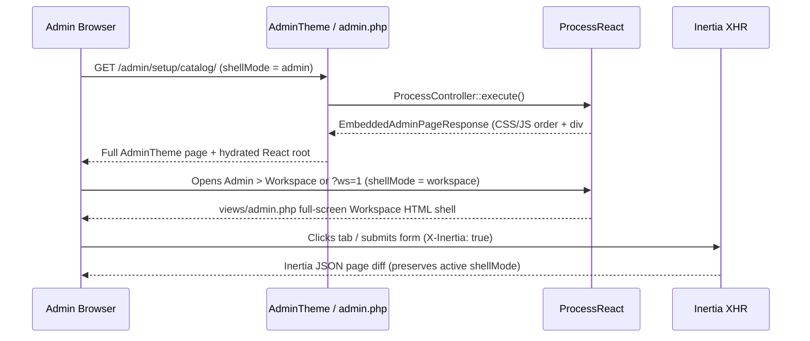

# 02 — Workspaces, Dual-Context Shell & Themes

Guide to building ProcessWire admin modules on `Totoglu\React\Inertia\ProcessReact`, exposing reliable `Setup > <Module>` flyout menus, integrating optionally with `ProcessReactWorkspace` (`Admin > Workspace`), and managing centralized themes and co-editing presence.

---

## Dual-Context Execution Model (`ProcessReact` & `InteractWithReact`)

A single React screen written for `ProcessReact` adapts automatically across two admin contexts ([InteractWithReact.php](../src/Inertia/InteractWithReact.php#L25-L32), [React.module.php](../React.module.php#L449)):

1. **Classic Admin Embedded Mode (`shellMode === 'admin'`):**
   When opened via `Setup > <Module>` without `?ws=1`, `_rw_ws=1`, or `X-React-Shell: workspace`, initial HTTP requests run natively through ProcessWire's `wire/core/admin.php` -> `ProcessController::execute()`. `InteractWithReact::inertiaRender()` returns an [`EmbeddedAdminPageResponse`](../src/Inertia/EmbeddedAdminPageResponse.php#L25-L209), which:
   - Enqueues `dist/ReactInertia.css` + module styles into `$config->styles` and ensures `dist/ReactInertia.js` precedes module/island scripts inside `$config->scripts` while keeping `/wire/` scripts first (`enqueueOrderedScripts()`).
   - Calls `$react->icons()->ensureAdminCss()` so admin vector icons render cleanly.
   - Injects `--pw-*` color scheme tokens and theme-mode bootstrap script into `AdminTheme::addExtraMarkup('head', ...)` across any active `AdminTheme`.
   - Clears redundant classic `processHeadline`, `breadcrumbs`, and `notices`, returning `<div class="pw-react-process-host">` wrapping Inertia's `<div id="app">`.
2. **Full-Screen Workspace Mode (`shellMode === 'workspace'`):**
   When `ProcessReactWorkspace` is installed and the user launches the module from `Admin > Workspace` (or navigates with `?ws=1`), requests bypass classic `AdminTheme` chrome and render inside [`views/admin.php`](../views/admin.php#L1-L129).
   - Both shell modes preserve ProcessWire's active color scheme via `<style id="pw-color-scheme-tokens">` and user theme overrides via `<style id="rw-theme-tokens">`.
   - When the user triggers `$session->redirect()` from within Workspace mode, [`FieldIntegrationHooks::hookSessionRedirectPreserveWorkspace()`](../src/Hook/FieldIntegrationHooks.php#L111,L177-L192) automatically preserves `?ws=1` via `React::withWorkspaceQuery()`.
   - When the optional `ProcessReactWorkspace` hub is **not** installed (`$react->isWorkspaceHubInstalled() === false`), `resolveShellMode()` always returns `'admin'`, and downstream modules function standalone with zero code changes.



> [!NOTE]
> `React` installs zero admin pages on its own. An `Admin > Workspace` top-level menu item only appears if you explicitly install `ProcessReactWorkspace` ([ProcessReactWorkspace.module.php](../ProcessReactWorkspace.module.php#L1-L22)). Downstream modules must list `'React'` (never `'ProcessReactWorkspace'`) in `getModuleInfo()['requires']`.

---

## `Setup > <Module>` Flyout Navigation (`executeNavJSON`)

Every `ProcessReact` module inherits `___executeNavJSON(array $options = []): string|array` and helper methods inside [`InteractWithReact`](../src/Inertia/InteractWithReact.php#L258-L445):

- **Clickable Root / Overview URLs:** [`ProcessReact::___executeNavJSON()`](../src/Inertia/ProcessReact.php#L42-L66) and `normalizeAdminNavJSONData()` rewrite empty (`""`) or `"./"` URLs to `resolveAdminProcessRootUrl()`, ensuring `Overview` items always receive an absolute admin root `href` in ProcessWire's dropdown menu JS instead of becoming unclickable `<a>` tags.
- **Structured Flyout Builder (`buildAdminNavJSON()`):** Accepts normalized item maps and handles entity decoding, badge labels (`badge`), section separators (`separator`), optional `"New ..."` header links (`add`, `addLabel`, `addIcon`), and icon normalization (`resolveAdminNavIcon()`).
- **Icon Registration Timing:** Keep downstream modules `'autoload' => false` and declare `'reactCapabilities' => ['icons', ...]` in `getModuleInfo()`, then call `IconManager::registerAdminIcons([...])` inside `init()` so `React` pulls the module lazily when generating `site/assets/vector-icons/VectorIcons.css` (without incurring cold-boot overhead on unrelated requests). For user-configured custom icons, pass `'dynamicIcon' => true` and `'fallbackIcon' => '...'` so unregistered slugs fall back safely.

### Canonical `ProcessReact` & `executeNavJSON()` Pattern

```php
<?php

declare(strict_types=1);

namespace ProcessWire;

use Totoglu\React\Icon\IconManager;
use Totoglu\React\Inertia\ProcessReact;

class ProcessCatalog extends ProcessReact
{
	public function init(): void
	{
		parent::init();

		IconManager::registerAdminIcons([
			'layout-dashboard',
			'shopping-bag',
			'adjustments-horizontal',
			'circle-plus',
		]);

		React::deferModuleRegistration(
			$this,
			function (React $react): void {
				$react->workspaces()->register([
					'id' => 'catalog',
					'title' => $this->_('Catalog'),
					'description' => $this->_('Manage products and inventory.'),
					'icon' => 'shopping-bag',
					'process' => 'ProcessCatalog',
					'component' => 'Catalog/Workspace',
					'permission' => 'catalog-view',
				]);
			}
		);
	}

	/**
	 * @param array<string, mixed> $options
	 * @return string|array<string, mixed>
	 */
	public function ___executeNavJSON(array $options = []): string|array
	{
		if (!$this->wire()->user->hasPermission('catalog-view')) {
			throw new WirePermissionException($this->_('Access denied.'));
		}

		$items = [
			[
				'url' => '',
				'label' => $this->_('Overview'),
				'icon' => 'layout-dashboard',
			],
			[
				'url' => 'products/',
				'label' => $this->_('Products'),
				'badge' => (string) $this->wire()->pages->count('template=product'),
				'icon' => 'shopping-bag',
				'separator' => true,
			],
			[
				'url' => 'settings/',
				'label' => $this->_('Settings'),
				'icon' => 'adjustments-horizontal',
			],
		];

		$navOptions = $options;
		$navOptions['add'] = 'new/';
		$navOptions['addLabel'] = $this->_('New Product');
		$navOptions['addIcon'] = 'circle-plus';

		return $this->buildAdminNavJSON($items, $navOptions);
	}
}
```

---

## Optional `ProcessReactWorkspace` Hub & Bento Dashboard

[`ProcessReactWorkspace`](../ProcessReactWorkspace.module.php#L20) extends [`WorkspaceLauncherProcess`](../src/Workspace/WorkspaceLauncherProcess.php#L14-L90), sets `useNavJSON => false`, and checks access via `React::checkAccess()` (requires superuser or at least one accessible registered workspace; guests are always rejected).

### Lazy Workspace, Widget, Shell Layout & Command Search Registration

Register definitions lazily via [`React::deferModuleRegistration()`](../React.module.php#L1315), [`React::deferShellLayoutRegistration()`](../React.module.php#L1599), and [`React::deferCommandSearchRegistration()`](../React.module.php#L1663) so `statsCallback`, `dataCallback`, and page/index queries execute only when requested:

- **Workspaces (`WorkspaceDefinition`):** Accepts `id`, `title`, `description`, `icon`, `process`, `url`, `permission`, `accessCallback`, `category`, `badge`, `order`, `logoUrl`, `component`, `stats`, `statsCallback`, `scripts`, `styles` ([WorkspaceDefinition.php](../src/Workspace/WorkspaceDefinition.php#L13-L60)).
- **Bento Dashboard Widgets (`WorkspaceWidgetDefinition`):** Accepts `id`, `title`, `workspaceId`, `subtitle`, `description`, `icon`, `size` (`'sm'`, `'md'`, `'lg'`, `'full'`, or grid span `'1'`–`'12'`), `order`, `permission`, `accessCallback`, `data`, and lazy `dataCallback` returning normalized keys `metrics`, `items`, `actions`, `status`, and `emptyText` ([WorkspaceWidgetDefinition.php](../src/Workspace/WorkspaceWidgetDefinition.php#L13-L80)).

### Multi-Shell Chrome (`AppShell`, `TopbarShellLayout`, `SidebarShellLayout`, `CommandSearchRegistry`)

- **Built-in & Custom Shell Layouts (`ShellLayoutRegistry`):** Ships `topbar` (order `10`) and `sidebar` (order `20`) layouts; custom layouts register in PHP (`React::deferShellLayoutRegistration()`) and TypeScript (`registerShellLayout()` from `@pw/react/layout`). Resolution precedence follows `{user-id}.json` personal `shellLayout` > `defaultShellLayout` module config > `'topbar'`.
- **Topbar Navigation (`TopbarShellLayout` / `WorkspaceTopbar`):** Renders the `Panel` return link (`[data-rw-admin-return]`), Workspace Hub link, up to `5` favorite-sorted inline workspace links (`MAX_INLINE_WORKSPACES = 5`), a `+N` `"More"` overflow popover switcher (`ModuleSwitcher` with live search and star pinning), Quick Jump (`Cmd/Ctrl+K`), and `UserAccountMenu`.
- **Sidebar Navigation (`SidebarShellLayout`):** Renders a collapsible navigation tree toggled via header button or `Cmd/Ctrl+B` (`set_sidebar_collapsed`), mobile slide-over navigation drawer, and an anchored desktop bottom `UserAccountMenu` (`variant="sidebar"` / `"sidebar-collapsed"`).
- **Command Palette 2.0 & `/_react/command-search`:** Groups navigation sections, shell layout / sidebar collapse / theme preset actions, and debounced server search results across `CommandSearchRegistry` providers (built-in `'pages'` editable-page provider at order `900`, plus deferred module providers enforcing `editable()`/`hasPermission()` and `UrlSanitizer::sanitizeSameOriginUrl()`).

### Per-User Preferences & Edit Co-Presence

| Feature | Store Class & Path | Capabilities |
|---|---|---|
| **Dashboard & Theme Preferences** | [`WorkspacePreferenceStore`](../src/Workspace/WorkspacePreferenceStore.php#L19-L65) (`site/assets/cache/React/workspaces/{user-id}.json`) | Persists starred favorites, widget visibility, widget order, grid sizes (`1`–`12`), `themeMode`, `themePreset`, `shellLayout`, `sidebarCollapsed`, and validated JSON preset export/import via `/_react/workspace-prefs`. Auto-reconciles when modules are uninstalled (`React::forgetSharedWorkspace()` / `forgetSharedWidget()` / `forgetDeferredRegistrations()`) or RBAC changes. |
| **Concurrent Edit Presence** | [`EditPresenceStore`](../src/Workspace/EditPresenceStore.php#L17-L95) (`site/assets/cache/React/presence/{sha256}.json`) | Tracks active co-editors per sanitized `resourceKey` (`15s` heartbeat, `45s` TTL, up to 8 sessions per user / 100 per resource) using `flock()` locking; broadcasts stale-form `lastSaved` version notices via `/_react/presence` and `React::notifyResourceSaved()`. |

---

## Centralized Theme Engine (`ThemeManager`)

[`ThemeManager`](../src/Theme/ThemeManager.php#L21-L120) unifies light/dark mode and color tokens across Workspaces, embedded `AdminTheme` panels, Inputfield islands, and top-layer `<dialog>` overlays ([`TOKEN_SCOPE`](../src/Theme/ThemeManager.php#L27-L32)):

1. **Theme Modes:** `system` (prefers-color-scheme), `light`, or `dark`. Authenticated users can toggle personal mode from the Workspace account menu (`/_react/workspace-prefs` `action=set_theme_mode`), synchronizing `{user-id}.json` and ProcessWire's `$user->meta('adminDarkMode')` ([ReactGatewayRouter.php](../src/Http/ReactGatewayRouter.php#L676-L687)). Respects `AdminThemeUikit` `noDarkMode`.
2. **Built-in Presets (`ThemePreset`):** `native` (inherits ProcessWire `--pw-*` variables directly), `neutral`, `slate`, `stone`, `ocean`, `indigo`, `teal`, and `custom` ([ThemePreset.php](../src/Theme/ThemePreset.php#L13-L60)).
3. **Precedence:** Personal user override (`{user-id}.json` `themePreset`) -> site-wide default configured under `Modules > Configure > React` (`themePreset`) -> `native` fallback. Passing `""` or `'default'` to `set_theme_preset` clears the personal override ([ReactGatewayRouter.php](../src/Http/ReactGatewayRouter.php#L688-L698)).
4. **Validated Custom CSS Tokens (`ThemeTokenParser`):** Parses `:root { ... }`, `.dark { ... }`, and `@media (prefers-color-scheme: dark)` blocks from `themeCustomTokens` into an allowlist of color, radius, font, and shadow tokens, rejecting `url()`, `expression()`, `@import`, CSS escapes, and markup-breaking characters ([API.md](../API.md#L127)). Custom tokens must define at least `--background`, `--foreground`, `--primary`, and `--primary-foreground` (`ThemeTokenParser::isComplete()`).
5. **Derived & Surface Mapping:** [`ThemeManager`](../src/Theme/ThemeManager.php#L39-L82) automatically derives card, popover, sidebar, button, masthead, and `--radius-button` tokens so partial palettes stay cohesive in both light and dark modes.

---

## Related Links

- Next: [03 — Inputfields, Forms & Rich Text (`InputfieldTiptap`)](./03-inputfields-forms-and-tiptap.md)
- Signatures: [API Reference §1–3](../API.md#L7-L180)
