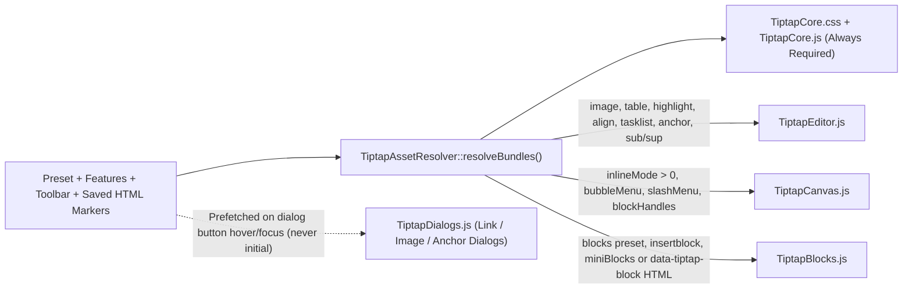

# 03 — Inputfields, Forms & Rich Text (`InputfieldTiptap`)

Reference guide for dual-mode `InputfieldReact` controls, `FormSchemaSerializer`, `MarkupReactTab`, `InputfieldReactKeyValue`, `InputfieldReactLink`, `InputfieldReactIcon` & `IconManager`, `MediaGateway` (`InputfieldReactImage`, `InputfieldReactFile`), `M2O`/`M2M`/`O2M`/`M2A` relational pickers, and `InputfieldTiptap` + `TextformatterTiptapMiniBlocks`.

---

## Dual-Mode `InputfieldReact` & `FormSchemaSerializer`

[`InputfieldReact`](../src/Inertia/InputfieldReact.php#L24-L105) extends ProcessWire's `InputfieldInertia` and operates in two environments without separate widget code:

1. **Classic Admin Forms (`ProcessPageEdit`, `ProcessTemplate`, `ProcessField`, `ProcessModule`):** Renders a `<div data-inertia-island="..." data-react-island="..." data-props="...">` container backed by a synchronized `<input type="hidden">` element, while loading `ReactInertia.css` + `ReactInertia.js` + only the control's own isolated `getModuleScriptAssets()` bundle (`MarkupReactTab::renderReady()` recursively prepares nested child Inputfield assets as well, [MarkupReactTab.module.php](../MarkupReactTab.module.php#L338-L382)).
2. **React `SchemaForm` Pages (`FormSchemaSerializer`):** [`FormSchemaSerializer`](../src/Form/FormSchemaSerializer.php#L53-L90) converts either a ProcessWire `InputfieldForm` / `InputfieldWrapper` tree (`serialize()`) or declarative field definitions (`serializeDefinitions()`) into JSON props for `<SchemaForm />` (`dist/SchemaForm.js`), prefetching only companion field bundles present in the schema.
   - When an `InputfieldReact` subclass inherits `___render()` from the base class, `InputfieldReact::toSchemaFormIsland()` provides a fast-path structured prop payload avoiding HTML render/parse overhead ([InputfieldReact.php](../src/Inertia/InputfieldReact.php#L90-L105)).
   - Supports `surface: 'card' | 'plain'` (when `surface === 'card'` and 2+ top-level tabs exist—such as `Content`, `Settings`, `Delete`—the `<div role="tablist" data-rw-card-tabs="above">` bar renders flush directly above `<Card data-rw-form-card="">`), declarative `'deleteTab'` configuration via `appendDeleteTab()` (promoting flat single-pane forms into `[Configuration | Delete]` confirmation tabs), `presenceKey` co-edit banners, `dirtyGuard`, conditional `showIf` / `requiredIf`, multi-language wrappers, `rwControl` / `data-rw-control` ProcessWire Inputfield opt-ins, and all canonical controls (`text`, `textarea`, `number`, `email`, `url`, `tel`, `phone`, `date`, `time`, `datetime`, `daterange`, `color`, `tags`, `combobox` including `country`/`countries`/`timezone`/`currency_code`, `unit_number` / `currency` with `unitVariant: 'currency'`, `segmented`, `spacing`, `range`, `range_slider`, `colspan`, `otp`, `password`, `markdown`, `rating`, `signature`, `calculation`, `select`, `radios`, `checkboxes`, `asmselect`, `multiselect`, `checkbox`, `toggle`, `repeater`, `keyvalue`, `link`, `icon`, `relation`, `file`, `image`, `tiptap`, [API.md](../API.md#L174)).

### Canonical Form Controls & `rwControl` Contract

Both `FormSchemaSerializer::serialize()` (from ProcessWire `Inputfield`s via `rwControl` / `data-rw-control`) and `FormSchemaSerializer::serializeDefinitions()` normalize onto identical `<SchemaForm />` field nodes, lazy-loading `dist/ReactCalendar.js` + `dist/ReactCalendar.css` for calendar/range pickers and `dist/ReactExtraFields.js` (`< 60 kB`) only when extended controls appear in the schema:

| Canonical Type | Aliases / Native Inputfield Mapping | Key Normalized Contract Props & Notes |
|---|---|---|
| `date` / `time` / `datetime` | `InputfieldDatetime` (resolved from `rwControl`, `dateInputFormat` / `timeInputFormat`) or `InputfieldText` (`rwControl`: `date` \| `time` \| `datetime`) | `inputType` (`date` \| `time` \| `datetime-local`), `datetimeMode` (`picker` \| `html` \| `text`), `hourFormat` (`24h` \| `12h`), `minuteStep`, `showSeconds`, `timezone`, `weekStartsOn`, `displayFormat`, `minTime`, `maxTime`, `min`, `max`. |
| `daterange` | `date_range`, `date-range`; `InputfieldDatetime` or `InputfieldText` (`rwControl='daterange'`) | Value `{ from, to }` (`YYYY-MM-DD..YYYY-MM-DD` and JSON normalized), `presets`, `numberOfMonths`, `weekStartsOn`, `min`, `max`. |
| `color` | `InputfieldText` (`rwControl='color'`) | `#hex` / `rgb` / `hsl` / `oklch` palette control with `swatches`, `allowAlpha`, `clearable`. |
| `tags` | `texttags`, `text_tags`, `InputfieldTextTags`; `InputfieldText` / `InputfieldSelect` (`rwControl='tags'`) | `list<string>` values, `suggestions` / `tagsList`, `allowDuplicates`, `allowCustom`, `maxItems`. |
| `combobox` | `searchable_select`, `country`, `country_code`, `countries`, `timezone`, `tz`, `currency_code`, `iso_currency`; `InputfieldSelect` / `InputfieldText` (`rwControl='combobox'` \| `'country'` \| `'timezone'` \| `'currency_code'`) | Searchable single or `multiple` picker with `clearable`, `emptyText`, `allowCustom`, structured `options` / `comboboxOptions` (`icon`, `description`, `subtitle`, `group`). `country`/`countries`, `timezone`, and `currency_code` auto-hydrate read-only options from `IntlCatalog` supporting `only`, `exclude`, `preferred`, `regions`, and `includeOffset`. |
| `phone` | `phone_number`, `phone-number`; `InputfieldText` (`rwControl='phone'`) | Compound international calling-code `Combobox` + national number input emitting canonical E.164 (`+905325551234`), with `defaultCountry`, `preferredCountries`, `only`, `exclude`, `clearable`, auto-detection of pasted `+<dial>` / `00<dial>` strings, and `IntlCatalog::phoneCountryItems()`. |
| `unit_number` | `currency`, `money`, `unit-number`, `unitnumber`; `InputfieldText` / `InputfieldInteger` / `InputfieldFloat` (`rwControl='unit_number'` \| `'currency'`) | Normalized `{ value, unit }`. Currency mode activates via `type: 'currency'`, `unitVariant: 'currency'`, or explicit `currency` / `currencies` (`defaultUnit` / `currency` defaults to `'EUR'`, currency list defaults to `['EUR', 'USD', 'TRY', 'GBP']`; non-currency units default to `'px'` and `['px', 'rem', '%', 'em', 'vw', 'vh']`); preserves `units`, `precision`, `locale`. |
| `segmented` | `button_group`; `InputfieldSelect` / `InputfieldCheckboxes` / `InputfieldRadios` / `InputfieldText` (`rwControl='segmented'`) | Single or `multiple: true` pill toggle bar with `iconOnly`, `fullWidth`, `useDeselect`, structured `options` / `segmentedOptions`. |
| `spacing` | `box_spacing`, `padding`, `margin`, `dimensions`; `InputfieldText` (`rwControl='spacing'`) | Normalized `{ top, right, bottom, left, unit, linked }`, `units`, `defaultUnit`, `sides`, `allowAuto`, `allowNegative`, `clearable`. |
| `range` / `range_slider` | `slider` (`range`); `dual_range`, `minmax`, `range` + `dual: true` (`range_slider`); numeric/text `rwControl` | Single scalar (`range`) or `{ min, max }` tuple (`range_slider` sets `dual: true`, `rangeMode: 'dual'`, `minDistance`, `min`, `max`, `step`). |
| `otp` | `pin`, `verification_code`, `totp`; `InputfieldText` (`rwControl='otp'`) | Slot code input with `otpLength` (`4`–`12`), `otpMode` (`numeric` \| `alphanumeric`), `otpSeparatorAfter`, `mask`, `clearable`. |
| `password` | `password_strength`, `new_password`; `InputfieldText` (`rwControl='password'`, distinct from API secret `isSecret`) | Strength & policy editor (`showStrength`, `showRequirements`, `allowGenerate`, `requireUppercase`, `requireLowercase`, `requireNumber`, `requireSymbol`, `confirmPassword`, `autoComplete`). |
| `markdown` | `md`, `markdown_editor`; `InputfieldTextarea` / `InputfieldText` (`rwControl='markdown'` or `editorMode='markdown'`) | Safe AST markdown composer with `previewMode` (`write` \| `preview` \| `split`), `allowSplit`, `showToolbar`. |
| `rating` | `InputfieldInteger` / `InputfieldFloat` / `InputfieldText` (`rwControl='rating'`) | Star score input with `maxStars` (`2`–`10`), `min`, `max`. |
| `signature` | `InputfieldTextarea` / `InputfieldText` (`rwControl='signature'`) | Canvas pad storing PNG/image data URIs with clear action. |
| `calculation` | `InputfieldFloat` / `InputfieldInteger` / `InputfieldText` (`rwControl='calculation'`) | Read-only computed field (`formula`, `precision`, `connection: { type: 'calculation', ... }`) evaluated via CSP-safe parser. |

---

## Tabs, Key-Value & Polymorphic Link Controls

| Module | Underlying Fieldtype & Role | Key Capabilities & Constants |
|---|---|---|
| [`MarkupReactTab`](../MarkupReactTab.module.php#L32-L42) | Layout wrapper (`InputfieldFieldset`) | Variants: `'line'`, `'segmented'`, `'vertical'`. Supports `addTab()`, `lazyLoad`, error count badges, `showIf`, and recursive `renderReady()` asset collection. Emits `dist/MarkupReactTab.js`. |
| [`InputfieldReactKeyValue`](../InputfieldReactKeyValue.module.php#L29-L43) | `FieldtypeText` / `FieldtypeTextarea` | Associative `Record<string, string>` editor with TSV paste, `minItems`/`maxItems` (`HARD_MAX_ITEMS = 1000`), `MAX_KEY_LENGTH = 255`, `MAX_VALUE_LENGTH = 16384`, `MAX_JSON_BYTES = 524288`, `MAX_JSON_DEPTH = 16`, blocked keys, and ReDoS-guarded `keyPattern`. Emits `dist/InputfieldReactKeyValue.js`. |
| [`InputfieldReactLink`](../InputfieldReactLink.module.php#L33-L75) | `FieldtypeText` / `FieldtypeTextarea` | Polymorphic destinations: `page`, `entry`, `url` (supports `#anchor`), strict `tel` (`^\+?[0-9]+$`), `email`, and isolated multi-profile media (`file`, `image`, `video`, or custom `mediaProfiles`). Governed by 6 feature flags (`enableLabel`, `enableAriaLabel`, `enableTarget`, `enableRel`, `enableAnchor`, `enableQuery`), multi-language `labels` / `ariaLabels`, `MAX_JSON_BYTES = 65536`, and `PageLinkMediaHostAdapter` storing link assets under `site/assets/files/{pageId}/links/{fieldName}/`. Emits `dist/InputfieldReactLink.js` (lazy-loads `ReactMedia.js` + `ReactMedia.css` only on media targets). |

---

## Centralized Vector Icon Engine (`InputfieldReactIcon` & `IconManager`)

[`IconManager`](../src/Icon/IconManager.php#L29-L135) compiles and queries `dist/vector-icons.json` (`5,491` outline + `1,054` filled = `6,545` icons across `41` categories plus shorthand aliases):

- **Search & Hydration Gateway (`/_react/icons`):** Strict read-only `GET`/`HEAD` JSON endpoint (`405` on `POST`) supporting `action=query` (search query, category, style `'all' | 'outline' | 'filled'`, pagination up to `limit = 96`) and `action=hydrate` (up to `100` definitions) backed by `dist/ReactIcons.js`.
- **Formatted Field Object (`ReactIconValue`):** Reading `$page->hero_icon` with `$page->of(true)` on a `FieldtypeText` configured with `InputfieldReactIcon` yields a `ReactIconValue` stringable object (`$set`, `$name`, `$variant`, `$size`, `$color`, `$strokeWidth`, `$background`, `$radius`, `$svg`, `$html`, `isEmpty()`, `toArray()`), while bypassing `TextformatterEntities` corruption via [`FieldIntegrationHooks`](../src/Hook/FieldIntegrationHooks.php#L61-L64).
- **Safe Inline SVG Sanitization:** Allowed child primitives are strictly geometry tags (`path`, `rect`, `circle`, `ellipse`, `line`, `polyline`, `polygon` in [`IconManager::ALLOWED_SVG_TAGS`](../src/Icon/IconManager.php#L41-L49)) and safe `#hex` / `var(--*)` colors.
- **ProcessWire Admin Vector Icons (`enableAdminVectorIcons`):** Injects a non-destructive `Vector Icon` picker under `Setup > Templates` and `Setup > Fields` (`showIf="vectorIcon=''"`) and supports `page_icon` values plus `IconManager::registerAdminIcons([...])` calls for navigation flyouts, compiling `mask-image` rules into `site/assets/vector-icons/VectorIcons.css` (`rwv--*` prefix, [`IconManager::ADMIN_PREFIX`](../src/Icon/IconManager.php#L31)).

```php
<?php

declare(strict_types=1);

namespace ProcessWire;

$icons = React::instance($this)->icons();
echo $icons->renderHtmlMarkup('sparkles', [
	'variant' => 'filled',
	'size' => 24,
	'color' => '#0d9488',
]);
```

---

## Media Studio (`InputfieldReactImage`, `InputfieldReactFile`, `MediaGateway`)

- **Drop-In Media Editors:** `InputfieldReactImage` (`extends InputfieldImage`) and `InputfieldReactFile` (`extends InputfieldFile`) work inside `ProcessPageEdit` (including Repeaters and `fileSchema` custom fields) and `<SchemaForm />`. Enabling `useReactMediaFields` under `Modules > Configure > React` upgrades all native Page Image/File fields automatically while keeping underlying `Pageimage`/`Pagefile` database rows unchanged ([React.module.php](../React.module.php#L2164-L2169)).
- **Shared Studio Bundle:** Both controls load `dist/ReactMedia.js` + `dist/ReactMedia.css` (`window.ReactMediaRuntime`) paired with lean field shims (`dist/InputfieldReactImage.js` or `dist/InputfieldReactFile.js`) ([vite.config.ts](../vite.config.ts#L45-L48)).
- **`MediaGateway` (`/_react/media`):** Issues HMAC-signed `mediaToken` envelopes bound to `$user->id` and executes `POST` + CSRF-validated actions: `upload`, `replace`, `transform` (`crop`, `rotate`, `flip`, `focus`), `inspect`, and `clone` ([MediaGateway.php](../src/Media/MediaGateway.php#L105-L137)).
- **Security & Raster Caps:** Raster dimensions are capped at `64 MP` (`MAX_RASTER_PIXELS = 64_000_000`) and `16,384 px` per axis (`MAX_RASTER_AXIS = 16_384`), default image extensions exclude SVG (`DEFAULT_IMAGE_EXTENSIONS` = `jpg, jpeg, png, gif, webp`) unless explicitly opted in and sanitized, and non-page hosts integrate via `MediaHostAdapterInterface` + `React::deferMediaHostRegistration()` ([React.module.php](../React.module.php#L579-L602)). When `InterventionImage` is installed, `inspect` extracts dominant colors, palettes, and LQIP previews.

---

## Relational Pickers (`M2O`, `M2M`, `O2M`, `M2A`) & `/_react/relation`

All four relational modules (`InputfieldReactM2O`, `InputfieldReactM2M`, `InputfieldReactO2M`, `InputfieldReactM2A`) extend [`AbstractInputfieldReactRelation`](../src/Relation/AbstractInputfieldReactRelation.php) and emit `dist/InputfieldReactRelation.js`:

- **8 Built-in Target Resources (`RelationResourceRegistry`):** `page`, `template`, `field`, `user`, `role`, `permission`, `language`, `module` ([RelationResourceRegistry.php](../src/Relation/RelationResourceRegistry.php#L10-L24)).
- **Cascading & Polymorphic Selection:** Supports `dependsOn` and `dependsResourceMap` dependency chains, reverse incoming O2M link/unlink/quick-create operations, and polymorphic `<resource>:<id>` M2A bindings without requiring `FieldtypePage`.
- **Signed Actions (`/_react/relation`):** Read queries (`search`, `tree`, `hydrate`, `o2m_list`) and CSRF/POST-enforced mutations (`quick_create`, `o2m_link`, `o2m_unlink`) verify `relationToken` (`RelationStateSigner`, bound to `$user->id`) and enforce `$config['readOnly']` / demo-mode guards ([ReactGatewayRouter.php](../src/Http/ReactGatewayRouter.php)).
- **Custom Adapters:** Implement `RelationResourceInterface` and register lazily via `React::deferRelationRegistration($this, function (RelationResourceRegistry $relations): void { ... })` ([React.module.php](../React.module.php#L1576)).

---

## Rich Text Editor (`InputfieldTiptap` & `TextformatterTiptapMiniBlocks`)

[`InputfieldTiptap`](../InputfieldTiptap.module.php#L54-L90) extends `InputfieldTextarea` (`ConfigurableModule`, `InertiaSerializable`), integrates with `FieldtypeTextarea` via `FieldIntegrationHooks::hookFieldtypeTextareaGetFieldSetups()` (`contentTypeHTML`), and wraps Tiptap v3 (`3.34.0`) with ProcessWire-native dialogs and sanitization.

### 1. Editor Profiles & Layered Settings

| Preset (`TiptapPresetCatalog`) | Initial Height / Max | Inline & Slash Menu | Intended Editorial Role |
|---|---|---|---|
| `core` | `180 px` / `480 px` | Framed (`0`), slash `0` | Compact comments, descriptions, plain formatting (`CORE_TOOLBAR`) |
| `editor` *(default)* | `260 px` / `640 px` | Framed (`0`), slash `0` | Standard rich text with alignment, highlights, task lists, image/table (`DEFAULT_TOOLBAR`) |
| `canvas` | `320 px` / unlimited | Chromeless (`inlineMode: 1`), slash `1`, `blockHandles` | Distraction-free document canvas (`BubbleMenu` + `/` commands + drag handles) |
| `blocks` | `320 px` / unlimited | Framed (`0`), slash `1`, `blockHandles` | Full editorial authoring with `insertblock` and built-in flat `miniBlocks` |

Effective configuration merges in order ([InputfieldTiptap.module.php](../InputfieldTiptap.module.php#L30-L50)): preset baseline -> module `defaultsJSON` -> inherited `settingsField` -> field config (`toolbar`, `bubbleToolbar`, `headlines`, `features`, `toggles`, `miniBlocks`, `imageFields`, `height`, `maxHeight`, `inlineMode`) -> `settingsJSON` (`replace_*` / `add_*` / `append_*` overrides). Canonical toolbar tokens (`ALL_TOOLBAR_TOKENS`) and feature flags (`ALL_FEATURES`, `ALL_HEADLINES`) live in [`TiptapContentPolicy`](../src/Tiptap/TiptapContentPolicy.php#L66-L155).

### 2. Modular Capability Pack Resolution (`TiptapAssetResolver`)

[`TiptapAssetResolver::resolveBundles()`](../src/Tiptap/TiptapAssetResolver.php#L77-L110) inspects the effective preset, active toolbar/bubble tokens, feature flags (`imgUpload`, `imgResize`, `bubbleMenu`, `slashMenu`, `blockHandles`), `miniBlocks`, and HTML markers already saved inside field values so previously saved records retain full formatting:



### 3. Native Media & Link Gateway (`/_react/tiptap`)

[`TiptapMediaLinkGateway`](../src/Tiptap/TiptapMediaLinkGateway.php#L46-L70) verifies `tiptapToken` (bound to `$user->id`) and serves native top-layer `<dialog>` modals (`TiptapDialogs.js`):
- **Page & Anchor Lookup:** Searches hierarchical site pages with multi-language `localUrl($lang)` resolution and relative `urlType` options.
- **Image Inspection & Variations (`resize`, `upload`):** Generates `-is` `Pageimage` width/height/crop/HiDPI variations across Page, RepeaterPage, cross-page, and `MediaHostAdapterInterface` hosts, validating uploads through `WireUpload`, `$sanitizer->validateFile()`, and `UPLOAD_IMAGE_EXTENSIONS` + CSRF enforcement.

### 4. Flat Editorial Mini-Blocks & Output Formatting

[`MiniBlockRegistry`](../src/Tiptap/MiniBlockRegistry.php#L16-L80) supports **strictly single-level (non-nested)** inline blocks inside rich text:
- **Built-in Types:** `callout`, `figure`, `details`, `pullquote`.
- **Custom Declarative Blocks:** Auto-discovered from `./site/tiptap/*.{yaml,yml,php}` (using allowed wrapper tags `aside`, `section`, `div`, `figure`, `blockquote` and scalar field types `text`, `textarea`, `url`, `image`, `select`, `toggle`) or registered dynamically via `InputfieldTiptap::registerMiniBlocks` hook (`[data-tiptap-block="{name}"]`).
- **Rendering (`TextformatterTiptapMiniBlocks`):** Assign `TextformatterTiptapMiniBlocks` to your `FieldtypeTextarea` field's Textformatters so `[data-tiptap-block="{name}"]` nodes render through `./site/templates/tiptap/{name}.php` when present, falling back to sanitized semantic HTML5 via `MiniBlockRenderer` / `MiniBlockHtmlSanitizer`.
- **Security & Multi-Language:** `TiptapContentPolicy` caps HTML length (`MAX_HTML_BYTES = 4_194_304`), strips unsafe tags/scripts/event attributes (`MarkupHTMLPurifier` + deterministic DOM allowlist fallback), enforces `Languages::editable()` per language tab, and uses [`FieldIntegrationHooks`](../src/Hook/FieldIntegrationHooks.php#L131-L150) around priority `50.0`/`150.0` to keep `LanguageSupport` from duplicating tabs.

---

## Related Links

- Next: [04 — Viewports & Data Providers](./04-viewports-and-data-providers.md)
- Signatures: [API Reference §3–8](../API.md#L108-L180)
