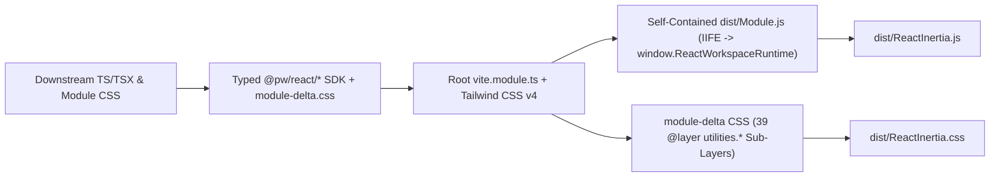

# 05 — Frontend Runtime, Typed SDK, i18n & Security

Deep reference for `React`'s 22-pass isolated Vite build pipeline, `dist/` bundle architecture, typed `@pw/react/*` SDK subpaths, Tailwind CSS v4 delta styling, ProcessWire native `i18n`, and end-to-end `/_react/*` security architecture.

---

## Multi-Pass Vite Build & Bundle Isolation

[`resources/build-bundles.mjs`](../resources/build-bundles.mjs#L1-L37) orchestrates **22 Vite passes** over [`resources/entries.manifest.mjs`](../resources/entries.manifest.mjs#L1-L51) and [`vite.config.ts`](../vite.config.ts#L636-L707):

1. **Core Pass (`VITE_BUILD_ENTRY=""`):**
   - Compiles 6 core JS entries (`ReactInertia`, `ReactLayout`, `ReactViewports`, `SchemaForm`, `ProcessReactWorkspace`, `ReactIcons`) and 4 core CSS entries (`ReactInertia`, `ReactMedia`, `TiptapCore`, `ReactCalendar`).
   - Executes `vectorIconCatalogPlugin()` to emit `dist/vector-icons.json` (`2.4M`) from the build-time icon dataset package ([vite.config.ts](../vite.config.ts#L159-L220)).
   - Applies [`createTailwindCascadeLayersPlugin()`](../resources/tailwind-layers.mjs) across CSS output.
2. **21 Isolated Self-Contained Passes (`ISOLATED_BUILD_ENTRIES`):**
   - Compiles each companion control, extended form pack, Tiptap addon pack, media shim, showcase bundle, and optional viewport engine as an isolated IIFE bundle (`createSelfContainedEntriesPlugin`) with zero Rollup shared chunks.
   - Maps imports of `react`, `react-dom`, `../ui`, `../hooks`, `../lib/*`, `../fields/media` (into `window.ReactMediaRuntime`), and `@tiptap/*` / `@tiptap/pm/*` (into `window.ReactTiptapRuntime`) onto virtual shims in [`optimizeReactWorkspaceDepsPlugin()`](../vite.config.ts#L222-L633).
   - Removes leftover `*.style.js` files and throws an error if any `ReactInertia-*.js` shared chunk is emitted ([build-bundles.mjs](../resources/build-bundles.mjs#L28-L35)).

### Measured `dist/` Artifact Inventory (32 Files)

| Bundle / File | Size | Role & Load Strategy |
|---|---|---|
| `ReactInertia.js` / `ReactInertia.css` | `684K` / `169K` | Core React 19 + Inertia v3 + Base UI + `--pw-*` tokens + `[data-rw-prose-root]` & `[data-rw-table]` CSS hooks (`< 700 kB` target) |
| `ReactLayout.js` | `241K` | Lazy Workspace chrome (`AppShell`, `TopbarShellLayout`, `SidebarShellLayout`, `ModuleSwitcher`, `UserAccountMenu`, `CommandPaletteModal`, `RecordHeader`, `useEditPresence`) |
| `ReactViewports.js` | `51K` | Shared `DataViewport` toolbar, filters, views, pagination shell |
| `SchemaForm.js` | `204K` | Core `<SchemaForm />` engine, Valibot validator, basic controls (`< 220 kB` target) |
| `ReactExtraFields.js` | `71K` | Lazy extended `<SchemaForm />` control pack (`color`, `tags`, `combobox`, `unit_number`/`currency`, `segmented`, `spacing`, `otp`, `password`, `markdown`) |
| `InputfieldReactCondition.js` | `55K` | Isolated visual/expression condition rule builder control bundle (`InputfieldReactCondition` & `<ConditionBuilder />`) |
| `ProcessReactWorkspace.js` / `ReactUiShowcase.js` | `28K` / `86K` | Optional Workspace Hub dashboard (`ReactWorkspace/WorkspaceLauncher`) and UI Showcase bundle |
| `ReactIcons.js` / `vector-icons.json` | `15K` / `2.4M` | Read-only client icon search/hydration bridge & build-time icon geometry catalog |
| `MarkupReactTable.js` / `MarkupReactCards.js` / `MarkupReactTab.js` | `9.9K` / `9.4K` / `6.3K` | Isolated per-module bundles loaded only when rendered |
| `InputfieldReactKeyValue.js` / `InputfieldReactIcon.js` / `InputfieldReactLink.js` / `InputfieldReactRelation.js` | `15K` / `41K` / `62K` / `67K` | Standalone companion Inputfield bundles |
| `ReactMedia.js` / `ReactMedia.css` | `74K` / `2.4K` | Shared `window.ReactMediaRuntime` studio dropzone, inspector `<dialog>`, crop/focus tools |
| `InputfieldReactImage.js` / `InputfieldReactFile.js` | `31K` / `26K` | Lean media field shims referencing `window.ReactMediaRuntime` |
| `TiptapCore.js` / `TiptapCore.css` | `515K` / `20K` | Base ProseMirror + Tiptap core (`window.ReactTiptapRuntime`) loaded whenever `InputfieldTiptap` mounts |
| `TiptapEditor.js` / `TiptapCanvas.js` / `TiptapBlocks.js` / `TiptapDialogs.js` | `95K` / `73K` / `39K` / `44K` | Modular Tiptap capability packs + strictly lazy `<dialog>` modals |
| `ReactGrid.js` / `ReactDnd.js` / `ReactCalendar.js` / `ReactCalendar.css` | `152K` / `55K` / `96K` / `5.2K` | Lazy viewport and calendar picker bundles loaded on demand via `viewScripts` / `viewStyles` or `<SchemaForm />` prefetch |

---

## Typed Downstream SDK (`@pw/react/*`) & Delta CSS Layers

Downstream ProcessWire modules avoid duplicating React/Inertia copies or manual `window.ReactWorkspaceRuntime` boilerplate by importing directly from `@pw/react/*` ([tsconfig.consumer.json](../tsconfig.consumer.json#L18-L23), root `vite.module.ts`):

| SDK Subpath | Exports Overview |
|---|---|
| `@pw/react/core` | `React`, `ReactDOM`, `ReactDOMClient`, `Inertia` (`Link`, `Head`, `router`, `usePage`, `visitSameModuleHref`), `registerPages`, `registerIslands`, `registerViewport`, `loadRuntimeScript`, `loadRuntimeStyle`, `preloadRuntimeScript`, `cn`, `DynamicIcon`, URL sanitizers |
| `@pw/react/ui` | `@base-ui/react` & design-system primitives (`Button`, `Badge`, `Card`, `Dialog`, `Sheet`, `Drawer`, `Tabs`, `Table`, `Toast`, `CommandDialog`, `StatCard`, `CliBox`, `EmptyState`, `ConfirmDialog`, sortable helpers) |
| `@pw/react/layout` | `AppShell`, `RecordHeader`, `EditPresenceBanner`, `ModuleSwitcher`, `UserAccountMenu`, `TopbarShellLayout`, `SidebarShellLayout`, `registerShellLayout`, `getShellLayout`, `listShellLayouts`, `resolveShellLayoutDefinition`, `useShellLayout`, `useEditPresence`, `postWorkspacePreferenceAction`, `renderNoticeMarkup` |
| `@pw/react/viewports` | `DataViewport`, `DataTableCanvas`, `DataCardsCanvas`, viewport registries & cell helpers |
| `@pw/react/fields` | `SchemaForm`, `SchemaField`, `ConditionBuilder`, all lazy field controls (`Color`, `Tags`, `Combobox` / `country` / `countries` / `timezone` / `currency_code`, `Phone`, `UnitNumber`, `Segmented`, `Spacing`, `Otp`, `Password`, `Markdown`, `ConditionBuilder`, `File`, `Image`, `Icon`, `Link`, `KeyValue`, `Relation`), `FieldControlIsland`, `ExtraFieldControlIsland`, condition helpers |
| `@pw/react/hooks` | `useTranslations`, `t`, `translate`, `useTheme`, `THEME_PRESETS`, `fetchGatewayJson`, `useDirtyFormBridge`, `useUnsavedChangesGuard`, `useEditPresence`, `KeyboardShortcutsProvider`, `useKeyboardShortcuts`, `useRegisteredKeyboardShortcuts`, `formatShortcutKeys` |
| `@pw/react/dnd` / `grid` / `calendar` | Lazy wrappers for sortable list/tree containers (`ReactDnd`), virtual data grid (`ReactGrid`), and date/calendar form pickers (`ReactCalendar`) |
| `@pw/react/optional` | Safe runtime lookup helpers (`getOptionalReactRuntime`, `requireReactRuntime`) |

### Module CSS Delta Isolation (`module-delta.css` + 39 Sub-Layers)

`dist/ReactInertia.css` intentionally scans only `React`'s own files. Downstream modules import [`resources/css/module-delta.css`](../resources/css/module-delta.css#L1-L7) (`@tailwind utilities source(none);`) with zero Preflight reset. [`resources/tailwind-layers.mjs`](../resources/tailwind-layers.mjs#L11-L51) partitions utilities across **39 deterministic cascade sub-layers** in ascending specificity order (`shorthand`, `axis`, `longhand`, `state`, `sm-*`..`xxl-*`, `container-3xs`..`container-7xl`, `container`, `media`), handling `[dir=rtl]`, `[dir=ltr]`, `:is(`, `.dark-theme`, named `@container` prefixes, and nested `@media`/`@supports` rules identically across both core and downstream stylesheets so late-loaded module utilities never override responsive or state utilities in `ReactInertia.css`. Opt-in scopes `[data-rw-prose-root]` and `[data-rw-table]` isolate typography and table styles where needed ([AGENTS.md](../AGENTS.md#L42)).

---

## Multi-Language (`i18n`) Architecture

- **Native ProcessWire Resolution Only:** [`TranslationCatalogService`](../src/I18n/TranslationCatalogService.php#L13-L35) and [`InteractWithReactTranslations`](../API.md#L146) resolve UI dictionaries through ProcessWire's native `LanguageTranslator` (`Setup > Languages`), with zero runtime CSV parsing.
- **Locale-Scoped `OnceProp` Delivery:** `buildInertiaI18nSharedProps()` pushes flattened translation dictionaries keyed by `rw_i18n:{locale}:{namespace}` (`namespace = 'core'` for `React` and the module's slug for downstream modules) once per locale switch, consumed in TypeScript via `useTranslations()` / `t()`.
- **Synchronized 6-Locale Import Packs:** `site/modules/React/languages/{en,tr,de,fr,es,ru}.csv` are generated and verified row-for-row against `LanguagePorter::exportCsv` by `ReactTranslationsTest.php` ([AGENTS.md](../AGENTS.md#L53)).

---

## Security Architecture

| Defense Layer | Implementation Details |
|---|---|
| **HMAC-SHA256 Signed Envelopes (`SignedTokenCodec`)** | Derives domain-separated HMAC-SHA256 subkeys from `$config->userAuthSalt` (`MIN_SALT_LENGTH = 16`, throws `WireException` if shorter). Binds tokens to `iat` (`DEFAULT_TTL = 86400s`, `MAX_CLOCK_SKEW = 300s`), `uid` (`$user->id`), and isolated domain claims (`viewport`, `presence`, `relation`, `media`, `tiptap`) so tokens cannot be replayed across endpoints or users. Caps token payload size (`MAX_TOKEN_BYTES = 65536`) and JSON depth (`32`) ([SignedTokenCodec.php](../src/Security/SignedTokenCodec.php#L14-L114)). |
| **RBAC & Authentication (`AccessGuard` & Module Checks)** | Every `/_react/*` handler checks `AccessGuard::isAuthenticated($user)` and `canEditFieldByLanguage(...)`. `React::checkAccess()` enforces superuser or accessible workspace permission on `/_react/presence` (verified alongside signed `presenceToken` and `canMarkSaved`) and `/processwire/workspace/`, while `/_react/command-search` verifies workspace or `page-edit` access + `$page->editable()` with `Cache-Control: no-store, private` ([AccessGuard.php](../src/Security/AccessGuard.php#L18-L108), [React.module.php](../React.module.php#L216-L236)). |
| **CSRF, HTTP Method & Demo Mode Guards (`ReactGatewayRouter`)** | Mutating actions on `viewport`, `workspace-prefs`, `presence`, `relation`, `media`, and `tiptap` enforce `POST` (`405`), validate ProcessWire `$session->CSRF` across `X-CSRF-TOKEN`, `X-XSRF-TOKEN`, or body parameters (`hash_equals`, `419`), block mutations when `$config->demo === true` (`403`), and bound JSON payloads (`2 MiB`, depth `64`) ([ReactGatewayRouter.php](../src/Http/ReactGatewayRouter.php#L127-L165,L332-L393)). |
| **Upload, SVG & Content Sanitization** | `UploadedFileValidator`, `MediaGateway`, and `TiptapMediaLinkGateway` stage uploads in `tempDir`, verify entity `editable()` / language `editable()` RBAC, validate MIME types (`finfo_file`) + `$sanitizer->validateFile()`, enforce `DOMDocument` SVG active-content rules, cap raster dimensions (`64 MP` / `16,384 px` axis), and sanitize HTML (`TiptapContentPolicy` + `DomFragmentHelper`) ([MediaGateway.php](../src/Media/MediaGateway.php#L43-L60), [API.md](../API.md#L184-L188)). |
| **Safe URL & CSV Output** | `UrlSanitizer` strips unsafe schemes across `WorkspaceDefinition`, viewports, and React link helpers (`sanitizeHref`, `sanitizeImageSrc`, `sanitizeSameOriginUrl`, `sanitizeAssetUrl`); CSV exports neutralize spreadsheet formula prefixes ([API.md](../API.md#L135), [MarkupReactViewport.php](../src/Viewport/MarkupReactViewport.php#L3307)). |

---

## Related Links

- Previous: [04 — Viewports & Data Providers](./04-viewports-and-data-providers.md)
- Hub Index: [docs/README.md](./README.md)
- Signatures: [API Reference](../API.md) | Contributor Rules: [AGENTS.md](../AGENTS.md)
