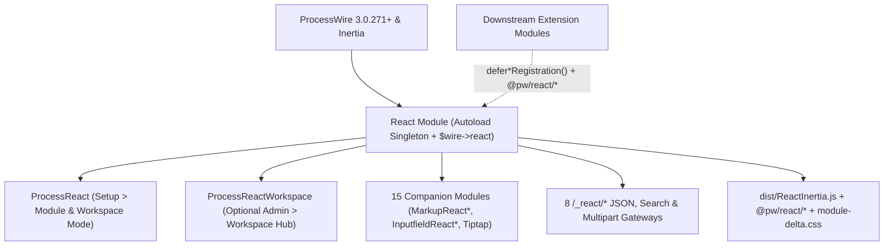

# React Architecture

`React` (`ProcessWire\React` / `Totoglu\React`) supplies the shared **React 19 + Inertia v3 + Tailwind CSS v4** UI runtime, dual-context admin controller (`ProcessReact`), **15 companion modules**, typed downstream SDK (`@pw/react/*`), CSS delta system (`module-delta.css`), and optional `ProcessReactWorkspace` (`Admin > Workspace`) hub for ProcessWire 3.0.271+ and PHP 8.4+.

> [!NOTE]
> Deep-dive subsystem chapters live alongside this overview in [`docs/01-architecture.md`](./01-architecture.md)–[`docs/05-frontend-runtime-sdk-and-security.md`](./05-frontend-runtime-sdk-and-security.md) and [`API.md`](../API.md).

---

## 1. Layering & Zero Downward Coupling

- **Strict UI-Layer Isolation:** `React` declares `requires => ['PHP>=8.4', 'ProcessWire>=3.0.271', 'Inertia']` and registers zero admin pages on its own. It contains zero hardcoded references to downstream modules (`tests/Unit/LayeringTest.php`).
- **Single-Point Namespace Registration:** `React::__construct()` registers `Totoglu\React` -> `__DIR__ . '/src/'` once via `WireClassLoader::addNamespace()`, without `require_once` or `class_exists` shims.
- **Lazy Discovery Deferral:** Downstream modules stay `'autoload' => false`, declare `'reactCapabilities' => [...]`, and attach work lazily via `React::deferModuleRegistration()`, `React::deferShellLayoutRegistration()`, `React::deferCommandSearchRegistration()`, `React::deferProviderRegistration()`, `React::deferRelationRegistration()`, `React::deferMediaHostRegistration()`, `React::deferViewportModeRegistration()`, and `React::deferLinkResolverRegistration()`, ensuring frontend and unrelated admin requests incur zero registry or query cost.

---

## 2. Dual-Context Shell & Multi-Shell Navigation

- **`ProcessReact` (`Totoglu\React\Inertia\ProcessReact`):** One React screen serves both `Setup > <Module>` (inline inside ProcessWire's active `AdminTheme` via `EmbeddedAdminPageResponse`) and optional `Admin > Workspace` (`?ws=1`, full-screen via `views/admin.php`).
- **Two Built-In Navigation Shells (`ShellLayout` / `ShellLayoutRegistry`):**
  - **`topbar` (`TopbarShellLayout` / `WorkspaceTopbar`):** Renders up to `5` favorite-sorted inline workspace links alongside a `+N` `"More"` overflow popover switcher (`ModuleSwitcher`), Quick Jump (`Cmd/Ctrl+K`), and `UserAccountMenu`.
  - **`sidebar` (`SidebarShellLayout`):** Renders a collapsible workspace navigation tree (`Cmd/Ctrl+B`), mobile navigation drawer, and anchored desktop bottom `UserAccountMenu`.
- **Command Palette 2.0 & `/_react/command-search`:** Groups navigation actions, layout/collapse/theme switches, and debounced server results from `CommandSearchRegistry` (`'pages'` editable-page search plus deferred module providers).
- **Centralized Theme Engine (`ThemeManager` & `ThemePreset`):** Site defaults (`native`, `neutral`, `slate`, `stone`, `ocean`, `indigo`, `teal`, `custom`) compile `--pw-*` and custom CSS tokens into `light-dark()` stylesheets, while per-user preferences (`themeMode`, `themePreset`, `shellLayout`, `sidebarCollapsed`) persist to `site/assets/cache/React/workspaces/{user-id}.json`.

---

## 3. Forms, Media, Icons, Relations, Viewports & Tiptap

- **Forms (`FormSchemaSerializer`):** Normalizes native `InputfieldForm` / `InputfieldWrapper` trees (`rwControl`, including `phone`, `country`/`countries`, `timezone`, `currency_code`, `condition_builder`) and declarative definitions onto `<SchemaForm />` (`dist/SchemaForm.js` + lazy `dist/ReactExtraFields.js`, `dist/InputfieldReactCondition.js`, and `dist/ReactCalendar.{js,css}`), supporting `surface: 'card'` (rendering flush `[data-rw-card-tabs="above"]` over `<Card>` when 2+ top tabs exist), `appendDeleteTab()` `[Configuration | Delete]` promotion, and signed `presenceToken` co-edit banners.
- **Tiptap Rich Text (`InputfieldTiptap` & `TextformatterTiptapMiniBlocks`):** Uses modular bundle loading (`TiptapCore.{js,css}` + conditional `TiptapEditor.js` / `TiptapCanvas.js` / `TiptapBlocks.js` + lazy `TiptapDialogs.js`) with `TiptapContentPolicy` HTML sanitization and flat `[data-tiptap-block]` mini-blocks.
- **Viewports, Icons, Media, Links & Relations:** `MarkupReactTable` / `MarkupReactCards` (`DataViewport`, `PagesDataProvider`, `ArrayDataProvider`, capability contracts, pluggable viewport modes), `IconManager` (`6,545` vector icons + `VectorIcons.css`), `MediaGateway` (`64 MP` / `16,384 px` bounds), `InputfieldReactLink` (`typeLabels`, isolated link media, custom resolvers), and `InputfieldReactM2O`/`M2M`/`O2M`/`M2A`.

---

## 4. Isolated Vite Build Pipeline & Security Model

- **22-Pass Build Isolation (`build-bundles.mjs`):** Compiles 6 core JS + 4 core CSS bundles + `vector-icons.json` (`32` total `dist/` files), plus 21 isolated IIFE entries consuming `window.ReactWorkspaceRuntime` with zero shared `ReactInertia-*.js` chunks.
- **39-Layer Delta CSS (`tailwind-layers.mjs`):** Downstream `module-delta.css` stylesheets compile unprefixed Tailwind utilities without Preflight and preserve deterministic `@layer utilities.*` specificity order alongside `ReactInertia.css`.
- **HMAC, CSRF & Lifecycle Security:**
  - `SignedTokenCodec` signs endpoint-scoped `stateToken`, `presenceToken`, `relationToken`, `mediaToken`, and `tiptapToken` envelopes using `$config->userAuthSalt` bound to `$user->id` (`uid`) and 24-hour `iat` TTL.
  - Mutating `/_react/*` gateways enforce authenticated users (`AccessGuard`), HTTP `POST`, `$session->CSRF`, `$config->demo` guards, and bounded JSON sizes (`2 MiB`, depth `64`).
  - `___uninstall()` clears `pages_meta` (`react_view_prefs_%`), `ReactViewPrefs` session data, presence/preference caches, `site/assets/vector-icons/`, and `site/assets/cache/React/`, and downstream modules detach hooks cleanly with `React::forgetSharedWorkspace()`, `React::forgetSharedWidget()`, `React::forgetSharedViewportMode()`, and `React::forgetDeferredRegistrations()`.
