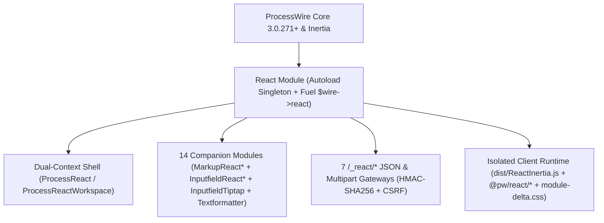

# React Documentation

Documentation for `ProcessWire\React` (`Totoglu\React`) and the optional `ProcessWire\ProcessReactWorkspace` hub module (`site/modules/React/`).

`React` provides the shared **React 19 + Inertia.js v3 + Tailwind CSS v4** UI runtime, dual-context admin controller (`ProcessReact`), dual-mode form controls and `SchemaForm` serializer, Tiptap v3 rich text editor (`InputfieldTiptap`), centralized vector icon subsystem (`IconManager`), interactive data viewports (`MarkupReactTable`, `MarkupReactCards`, `MarkupReactTab`), typed client SDK (`@pw/react/*`), and HMAC/CSRF-hardened `/_react/*` gateways for ProcessWire 3.0.271+ on PHP 8.4+.

---

## Start Here by Goal

| Goal / Reader Role | Start Reading | Then Consult |
|---|---|---|
| Understand internals, tech stack, CI/test gates, and ADRs (`doc-and-modernize`) | [01 — Architecture & Technical Deep-Dive](./01-architecture.md) | [AGENTS.md](../AGENTS.md) |
| Build a dual-context `Setup > <Module>` / `Admin > Workspace` `Process` module | [02 — Workspaces, Dual-Context Shell & Themes](./02-workspaces-and-admin-shell.md) | [API.md §1–2](../API.md#L7-L106) |
| Configure or build `SchemaForm`, media, relation, icon, link, key-value, tab, or Tiptap fields | [03 — Inputfields, Forms & Rich Text (`InputfieldTiptap`)](./03-inputfields-forms-and-tiptap.md) | [API.md §3–8](../API.md#L108-L180) |
| Render interactive tables, cards, custom viewports, or `ReactDataProviderInterface` adapters | [04 — Viewports & Data Providers](./04-viewports-and-data-providers.md) | [API.md §9](../API.md#L183-L189) |
| Bundle downstream TypeScript with `@pw/react/*`, delta CSS, i18n packs, or audit `/_react/*` security | [05 — Frontend Runtime, Typed SDK, i18n & Security](./05-frontend-runtime-sdk-and-security.md) | [API.md §10](../API.md#L192-L212) |
| Look up exact PHP signatures, return shapes, or companion module names | [API Reference](../API.md) | [Module README](../README.md) |

---

## Documentation Chapters

| Chapter | Title | Covered Topics |
|---|---|---|
| **[01](./01-architecture.md)** | **Architecture & Technical Deep-Dive** | Snapshot identity, verified stack inventory, entry points, command & CI matrix, deployment/runtime surface, C4 Mermaid diagrams, layering governance, cross-cutting concerns, and architectural decisions (ADRs). |
| **[02](./02-workspaces-and-admin-shell.md)** | **Workspaces, Dual-Context Shell & Themes** | `ProcessReact` & `InteractWithReact`, `EmbeddedAdminPageResponse` vs `views/admin.php`, `___executeNavJSON()` / `buildAdminNavJSON()`, optional `ProcessReactWorkspace`, Bento widgets, preferences & edit presence, and `ThemeManager` presets. |
| **[03](./03-inputfields-forms-and-tiptap.md)** | **Inputfields, Forms & Rich Text (`InputfieldTiptap`)** | `InputfieldReact` dual-mode islands, `FormSchemaSerializer`, `MarkupReactTab`, `InputfieldReactKeyValue`, `InputfieldReactLink`, `InputfieldReactIcon` & `IconManager`, `MediaGateway`, `M2O`/`M2M`/`O2M`/`M2A` relations, `InputfieldTiptap` capability packs, and flat mini-blocks. |
| **[04](./04-viewports-and-data-providers.md)** | **Viewports & Data Providers** | `MarkupReactViewport`, `MarkupReactTable`, `MarkupReactCards`, pluggable view modes, `ProviderRegistry` (`pages:`, `array:`, deferred adapters), all 10 capability contracts, `ReactRecord` visuals, and `/_react/viewport` mutations. |
| **[05](./05-frontend-runtime-sdk-and-security.md)** | **Frontend Runtime, Typed SDK, i18n & Security** | Multi-pass Vite isolation (`build-bundles.mjs`), 29 `dist/` artifacts, `@pw/react/*` subpaths, Tailwind v4 `module-delta.css` 32 utility sub-layers, ProcessWire `OnceProp` `i18n`, `SignedTokenCodec`, CSRF, and gateway threat controls. |

---

## System Overview

---

## Related Module Artifacts

- [Module README](../README.md) — Quick-start installation, companion module summary, configuration options, and reading map.
- [API Reference](../API.md) — Canonical PHP signatures, service accessors, constants, and client bundle inventory.
- [Agent Guidelines](../AGENTS.md) — Internal invariants for contributors modifying `site/modules/React/`.
- [Agent Consumer Playbook](../.agents/skills/pw-react/SKILL.md) — Task workflow for building downstream ProcessWire features on `React`.
